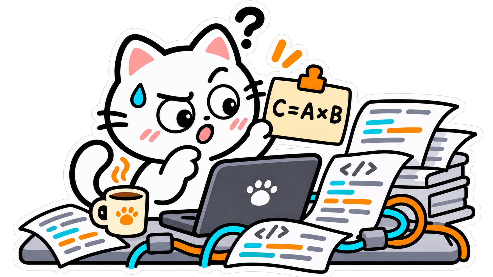

# Efficient GEMM with TileLang


## Introduction

In our earlier CUDA tutorials, we explored several ways to make GEMM faster, such as **shared memory**, **Tensor Cores**, and **pipelines**.

Unfortunately, writing CUDA kernels has a way of getting pretty involved.
The core computation often takes just a few lines of code. 
But once we've dealt with **thread mapping, data movement, and synchronization**, those few lines can be hard to spot.

<p align="center">
  
</p>

**By hand, we might spend all night getting a kernel to work. With vibe coding, we might have it working in minutes and spend all night figuring out how it works.**

<p align="center">
  
</p>

We'd like a kernel that's easier to write and easier to follow. 
So, ***TileLang*** lets us work with whole tiles while the compiler handles much of the thread mapping. We'll revisit GEMM with the example in [`00_basic_gemm.py`](00_basic_gemm.py).


## 1. Taking It for a Spin

Before we get into the code, let's see it in action. With the [environment set up](../README.md#quick-start), we can run this from the project root.

```bash
uv run 01-GEMM/00_basic_gemm.py
```

The first run may take a moment while TileLang compiles the kernel.    
If all goes well, we'll see **`correctness passed`**, followed by timings for TileLang and PyTorch.


And there we go!   
Our first TileLang kernel is up and running.

This screenshot was captured on an `NVIDIA GeForce RTX 4070 SUPER`, with `M = N = K = 1024`. The TileLang kernel takes 61.44 μs, while PyTorch's `torch.mm` takes 50.18 μs.   
All right, it looks like PyTorch wins this round. 
The TileLang kernel takes about 22% longer in this test.

Those timings give us a starting point. We can also try a smaller case that's easier to follow, then an uneven shape to check the tile boundaries.

```bash
# Smaller matrices
uv run 01-GEMM/00_basic_gemm.py --shape 128 128 128

# Partial tiles in all three dimensions
uv run 01-GEMM/00_basic_gemm.py --shape 129 257 259
```

If you'd like a peek under the hood, `--source` prints the CUDA code TileLang generates.

```bash
uv run 01-GEMM/00_basic_gemm.py --source
```


## 2. Math and Code

You’ve seen it run. The calculation is still the same familiar matrix product.

$$
C_{M\times N}=A_{M\times K}B_{K\times N}.
$$

Each element of the `M × N` output is the sum of `K` products. `A`, `B`, and `C` use FP16 storage, with FP32 accumulation to reduce rounding error.

Here’s the kernel:

```python
import tilelang
import tilelang.language as T


@tilelang.jit
def gemm(A, B, C, BM=128, BN=128, BK=32):
    M, N, K = T.const("M, N, K")
    A: T.Tensor((M, K), T.float16)
    B: T.Tensor((K, N), T.float16)
    C: T.Tensor((M, N), T.float16)

    with T.Kernel(T.ceildiv(N, BN), T.ceildiv(M, BM), threads=128) as (bx, by):
        A_shared = T.alloc_shared((BM, BK), T.float16)
        B_shared = T.alloc_shared((BK, BN), T.float16)
        C_acc = T.alloc_fragment((BM, BN), T.float32)
        T.clear(C_acc)
        for k in T.Pipelined(T.ceildiv(K, BK), num_stages=3):
            T.copy(A[by * BM, k * BK], A_shared)
            T.copy(B[k * BK, bx * BN], B_shared)
            T.gemm(A_shared, B_shared, C_acc)
        T.copy(C_acc, C[by * BM, bx * BN])
```


## 3. A Template to Build On

For later kernels, we can keep the same imports:

```python
import tilelang
import tilelang.language as T
```

`T` is a short name for `tilelang.language`, which provides operations such as `T.copy` and `T.gemm`.

Let's give GEMM two inputs and a place to write the result:

```python
@tilelang.jit
def gemm(A, B, C, BM=128, BN=128, BK=32):
    M, N, K = T.const("M, N, K")
    A: T.Tensor((M, K), T.float16)
    B: T.Tensor((K, N), T.float16)
    C: T.Tensor((M, N), T.float16)
```

The `@tilelang.jit` decorator marks `gemm` for JIT compilation.

`A` and `B` are the inputs, while `C` is the output.
The name `A` keeps the equation tidy.
However, the compiler would appreciate a few more details:

```python
A: T.Tensor((M, K), T.float16)
```

This tells TileLang that `A` has `M` rows, `K` columns, and FP16 elements. The compiler can use this information before GPU memory is allocated.


The shapes above use `M`, `N`, and `K`, declared with `T.const`. To compile this GEMM for a specific shape, we supply their values from Python:

```python
kernel = gemm.compile(M=M, N=N, K=K)
```

Here, the values on the right are Python integers. `.compile()` returns the callable kernel, which we save as `kernel` for use with our tensors later.

`M`, `N`, and `K` describe the full matrices. `BM`, `BN`, and `BK` describe the smaller tiles used to compute them:

| Parameter | Meaning | Default |
| --- | --- | ---: |
| `BM` | Rows in one output tile | 128 |
| `BN` | Columns in one output tile | 128 |
| `BK` | Reduction elements processed in one loop step | 32 |


The output tile stays fixed while matching tiles from `A` and `B` move along `K`. Each pair adds another partial product to the same accumulator. The animation uses `BM = BN = BK = 2` to keep the numbers readable.

The defaults in the code produce `128 × 128` output tiles and advance through `K` in steps of `32`.


## 4. Inside the Kernel

Many GPU kernels share a common structure, whether we write them in Triton, CUDA, or TileLang. We can organize the work into four basic steps:

1. **Divide the work into tiles.** Split the output into smaller tiles and assign each tile to a group of threads.
2. **Load the inputs.** Locate and load the input data needed to compute the current tile.
3. **Compute and accumulate.** Perform the computation on the loaded data. For reductions such as GEMM, repeat the load-and-compute steps and accumulate partial results until the output tile is complete.
4. **Store the result.** Write the completed output tile back to global memory.


```python
with T.Kernel(T.ceildiv(N, BN), T.ceildiv(M, BM), threads=128) as (bx, by):
    A_shared = T.alloc_shared((BM, BK), T.float16)
    B_shared = T.alloc_shared((BK, BN), T.float16)
    C_acc = T.alloc_fragment((BM, BN), T.float32)
    T.clear(C_acc)

    for k in T.Pipelined(T.ceildiv(K, BK), num_stages=3):
        T.copy(A[by * BM, k * BK], A_shared)
        T.copy(B[k * BK, bx * BN], B_shared)
        T.gemm(A_shared, B_shared, C_acc)

    T.copy(C_acc, C[by * BM, bx * BN])
```


One more thing, `threads=128` gives each block 128 threads or four warps on NVIDIA GPUs. TileLang determines how the tile’s values and operations are distributed across them.

---
OK, let's give it some space for the input tiles and partial sums.  
Before the loop, we need to initialize these sums to zero with `T.clear(C_acc)`.   
`T.alloc_shared` keeps the inputs in shared memory.    
`T.alloc_fragment` keeps the partial sums in registers.   
For both calls, we pass the tile shape and element type.
The input buffers need no clearing, as `T.copy` overwrites them on each iteration.  

```python
A_shared = T.alloc_shared((BM, BK), T.float16)
B_shared = T.alloc_shared((BK, BN), T.float16)
C_acc = T.alloc_fragment((BM, BN), T.float32)
T.clear(C_acc)
```


---


All set. But it seems that these matrices aren't going to multiply themselves.   
Let's go on, load two input tiles, multiply them, and add the product to `C_acc`.

```python
for k in T.Pipelined(T.ceildiv(K, BK), num_stages=3):
    T.copy(A[by * BM, k * BK], A_shared)
    T.copy(B[k * BK, bx * BN], B_shared)
    T.gemm(A_shared, B_shared, C_acc)
```

`k` is the tile index along `K`, and `k * BK` gives the starting position for each pair. With `K = 1024` and `BK = 32`, we process 32 pairs of input tiles, all contributing to the same `C_acc`.

Do you remember that old joke about putting an elephant in a fridge? Unfortunately, this time we've got 100 elephants waiting. With a fridge for each elephant and three people sharing the work, one person can open the next door while another puts an elephant in and the third closes the previous door. That's the idea behind pipelining.


Back in GEMM, our jobs are fetching tiles and multiplying them. `T.copy` brings in a pair of tiles, `A_k` and `B_k`, and `T.gemm` adds their product to the same accumulator.

`T.Pipelined` asks TileLang to fetch later pairs while computing with the current pair.    
Here, `num_stages=3` requests three input-buffer slots to rotate through. One pair can be in use while the others are ready or still loading. These slots hold different batches of inputs. 

---

After the loop, `C_acc` holds the finished output tile. One last copy writes it to `C` and converts the sums from FP32 to FP16.

```python
T.copy(C_acc, C[by * BM, bx * BN])
```


## 5. Run, Check, and Measure

Back in Python, we can give our kernel and PyTorch the same random matrices. A second opinion never hurts.

```python
torch.manual_seed(0)
# Disable reduced-precision reductions for the reference.
torch.backends.cuda.matmul.allow_fp16_reduced_precision_reduction = False
a = torch.randn((M, K), device="cuda", dtype=torch.float16)
b = torch.randn((K, N), device="cuda", dtype=torch.float16)
c = torch.empty((M, N), device="cuda", dtype=torch.float16)
ref = torch.empty_like(c)

kernel = gemm.compile(M=M, N=N, K=K)
kernel(a, b, c)
torch.mm(a, b, out=ref)
torch.testing.assert_close(c, ref, rtol=1e-2, atol=1e-2)
```

Small rounding differences are normal, and `assert_close` allows for them within the chosen tolerance.

Once the check passes, we can see how the timings compare. Both calls reuse their buffers, with compilation and allocation already out of the way.

```python
for name, fn in (
    ("TileLang", lambda: kernel(a, b, c)),
    ("PyTorch", lambda: torch.mm(a, b, out=ref)),
):
    p10_ms, median_ms, p90_ms = do_bench(
        fn, backend="event", quantiles=[0.1, 0.5, 0.9]
    )
    tflops = 2 * M * N * K / median_ms / 1e9
```

`do_bench` takes care of warmup and repeated runs. We report the median, with p10 and p90 showing the variation. Its [Event backend](https://github.com/tile-ai/tilelang/blob/v0.1.13/tilelang/profiler/bench.py) flushes L2 before each timed call for both implementations.

The times come back in milliseconds. The script displays microseconds and estimates TFLOP/s from `2 * M * N * K` operations, counting a multiply and an add per term.
