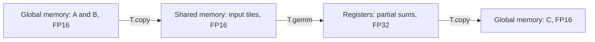

# Efficient GEMM with TileLang


## Introduction

In our earlier CUDA tutorials, we explored several ways to make GEMM faster, such as **shared memory**, **Tensor Cores**, and **pipelines**. 

We now have the basic tools, including CUDA. 
But, writing CUDA kernels can somtimes be a little complicated.    
As a CUDA kernel grows, more code goes into thread mapping, data movement, and synchronization.  
The calculation itself can get lost in all those details. 
What starts as a short equation can turn into a long night of coding, with a laptop and c cup of coffee for company.


That’s where TileLang comes in. 
Let us revisit GEMM with TileLang. 
The complete example is in [`00_basic_gemm.py`](00_basic_gemm.py).


## Get it Running

> [!NOTE] 
> You don't need to go through the code line by line just yet. Let's run the example first and see what it does. 

If you haven’t set up the project environment yet, follow [Environment Setup](../00-Setup/README.md).


Then, run `01-GEMM/00_basic_gemm.py` from the project root:

```bash
uv run 01-GEMM/00_basic_gemm.py
```

Are you finished?    
Have a try!   
You've just run the first GEMM kernel with TileLang.

Let's check out what has happened.


Look! 
The first two INFO messages just show TileLang compiling the kernel.
Ignore them!

May be check the setup. I ran this example on an `NVIDIA GeForce RTX 4070 SUPER`, with `M=K=N=1024`. 
A Nice GPU, huh?

Next, correctness passed tells us that our result matches PyTorch within the allowed tolerance. 
A good start, isn't it?

Time to see if our first kernel can keep up with PyTorch. 
Our TileLang kernel takes takes 61.44 μs, while PyTorch's `torch.mm` takes 50.18 μs. 

Well, perhaps PyTorch wins this round! Our kernel takes about 22% more time in this test. We’ll use these numbers as a starting point for later experiments.

We've only tested one matrix shape so far. 
Let's give out kernel two more tests before we look at the code. 

```bash
# Try a smaller case
uv run 01-GEMM/00_basic_gemm.py --shape 128 128 128

# Try some less tidy dimensions
uv run 01-GEMM/00_basic_gemm.py --shape 129 257 259
```

The small case will be easier to follow when we walk through the code. The odd sizes help us check whether the kernel handles the matrix edges correctly. We’ll see how that works later.


You can also add `--source` to see the CUDA code generated by TileLang.

```bash
uv run 01-GEMM/00_basic_gemm.py --source
```


## 2. Math and Code

You’ve seen it run. The calculation is still the same familiar matrix product.

$$
C_{M\times N}=A_{M\times K}B_{K\times N}.
$$

Each element of the `M × N` output is the sum of `K` products. We store `A`, `B`, and `C` in FP16 and accumulate the products in FP32. This way, we save memory and keep the sums more accurate.

Here’s the kernel: 

```python
import tilelang
import tilelang.language as T


@tilelang.jit
def gemm(A, B, C, BM=128, BN=128, BK=32):
    M, N, K = T.const("M, N, K")
    A: T.Tensor((M, K), T.float16)
    B: T.Tensor((K, N), T.float16)
    C: T.Tensor((M, N), T.float16)

    with T.Kernel(T.ceildiv(N, BN), T.ceildiv(M, BM), threads=128) as (bx, by):
        A_shared = T.alloc_shared((BM, BK), T.float16)
        B_shared = T.alloc_shared((BK, BN), T.float16)
        C_acc = T.alloc_fragment((BM, BN), T.float32)
        T.clear(C_acc)
        for k in T.Pipelined(T.ceildiv(K, BK), num_stages=3):
            T.copy(A[by * BM, k * BK], A_shared)
            T.copy(B[k * BK, bx * BN], B_shared)
            T.gemm(A_shared, B_shared, C_acc)
        T.copy(C_acc, C[by * BM, bx * BN])
```


## 3. A Template to Build On

We already have a head start on our next kernel. We can reuse these imports and the JIT decorator from this example.

```python
import tilelang
import tilelang.language as T
```

We use `tilelang` for compilation and `T` for operations such as `T.copy` and `T.gemm`.    
With `@tilelang.jit`, we prepare our function for TileLang compilation.

For GEMM, we fill in the function and tensor definitions like this.

```python
@tilelang.jit
def gemm(A, B, C, BM=128, BN=128, BK=32):
    M, N, K = T.const("M, N, K")
    A: T.Tensor((M, K), T.float16)
    B: T.Tensor((K, N), T.float16)
    C: T.Tensor((M, N), T.float16)
```

When we write another operator, we give the function its own name and arguments, then update the dimensions, tensor shapes, and dtypes.

We declare the dimensions with `T.const` and supply their values when we compile the kernel from Python.

```python
kernel = gemm.compile(M=M, N=N, K=K)
```

With `T.Tensor`, we tell the compiler each argument’s shape and dtype. We create the actual tensors with PyTorch before calling the compiled kernel.

We also choose `BM`, `BN`, and `BK` to set the tile sizes for our GEMM.

| Parameter | Meaning | Default |
| --- | --- | ---: |
| `BM` | Rows in one output tile | 128 |
| `BN` | Columns in one output tile | 128 |
| `BK` | Reduction elements processed in one loop step | 32 |

With these defaults, each block computes a `128 × 128` output tile and moves through `K` in chunks of `32`. We can try other tile sizes in later experiments.

## 4. One Output Tile per Block

We use `T.Kernel` to assign those output tiles to GPU blocks.

```python
with T.Kernel(T.ceildiv(N, BN), T.ceildiv(M, BM), threads=128) as (bx, by):
```

The grid has `ceil(N / BN)` blocks along `x` and `ceil(M / BM)` blocks along `y`. Its coordinates, `bx` and `by`, play the same role as block indices in CUDA.

For block `(bx, by)`, the first output row and column are

$$
r_0=by\cdot BM,\qquad c_0=bx\cdot BN.
$$

The block computes the tile

$$
C[r_0:r_0+BM,\;c_0:c_0+BN],
$$

with the final tile clipped to the matrix boundary when necessary.

For example, a `1024 × 1024` output with `128 × 128` tiles needs an `8 × 8` grid: 64 blocks in total. Moving one block along `x` advances 128 columns; moving one block along `y` advances 128 rows.

Each block has 128 threads, or four NVIDIA warps. Those threads cooperate on all `128 × 128` output elements. **The number of threads is not the number of output elements.** Each thread can hold and compute several values.

We have now fixed which block owns each output tile. Next, we need to decide where its data lives.

## 5. Three Buffers, Three Roles

Inside each block, we allocate two input buffers and one accumulator:

```python
A_shared = T.alloc_shared((BM, BK), T.float16)
B_shared = T.alloc_shared((BK, BN), T.float16)
C_acc = T.alloc_fragment((BM, BN), T.float32)
T.clear(C_acc)
```

Their shapes follow directly from the tile multiplication:

$$
(BM\times BK)\;(BK\times BN)\longrightarrow(BM\times BN).
$$

| Buffer | Memory | Purpose |
| --- | --- | --- |
| `A_shared` | Shared memory | Hold the current `BM × BK` input tile |
| `B_shared` | Shared memory | Hold the current `BK × BN` input tile |
| `C_acc` | A fragment distributed across thread registers | Hold the `BM × BN` partial sums |

Shared memory lets the threads in a block reuse input values. Values from `A` contribute to multiple output columns, while values from `B` contribute to multiple output rows.

`T.alloc_fragment` describes a logical tile whose elements are distributed across threads. Each thread holds part of `C_acc`. The layout and compiler determine the exact distribution.

At the tile level, the data follows this path:



The accumulator stays in registers across the reduction loop. FP32 accumulation helps reduce rounding error as the sum grows. We clear it once before the loop because every step adds to the same partial sums.

This is the same reuse pattern we used in CUDA. TileLang lets us express it directly through the buffer shapes and memory locations.

## 6. Inside the K Loop

The main loop contains just two copies and one tile multiplication:

```python
for k in T.Pipelined(T.ceildiv(K, BK), num_stages=3):
    T.copy(A[by * BM, k * BK], A_shared)
    T.copy(B[k * BK, bx * BN], B_shared)
    T.gemm(A_shared, B_shared, C_acc)
```

Here, `k` is a **tile index** along the reduction dimension. The first step starts at reduction position `0`, the next at `BK`, and so on. This is why the address offset is `k * BK`.

For each step, the block needs the following regions:

$$
A[r_0:r_0+BM,\;kBK:(k+1)BK]
$$

and

$$
B[kBK:(k+1)BK,\;c_0:c_0+BN].
$$

The source expressions in `T.copy` give the starting positions. TileLang uses the destination buffer shapes to determine the copy regions. Although `A[by * BM, k * BK]` looks like a scalar access in Python, this DSL operation copies a whole tile.

Once both input tiles are available, `T.gemm` performs

$$
C_{\mathrm{acc}}\mathrel{+}=A_{\mathrm{shared}}B_{\mathrm{shared}}.
$$

Across the loop, these updates build the sum for each output element.

$$
C_{i,j}=\sum_{k=0}^{K-1}A_{i,k}B_{k,j}.
$$

On supported NVIDIA GPUs, this operation can use Tensor Core instructions. The exact instruction path depends on the target and compilation choices; the generated code lets us inspect it.

For the default `K = 1024` and `BK = 32`, the loop has 32 steps. All 32 updates contribute to the same output tile.

There is also a scheduling choice in the loop: `num_stages=3`. This asks the compiler to build a software pipeline so that loading later tiles can overlap with work on earlier tiles. The three stages do not mean three loop iterations or three threads.

More stages can provide more overlap, but they can also require more storage and reduce the number of blocks that fit on the GPU at once. We will study that tradeoff with measurements in the pipeline lesson. The [software pipeline guide](https://www.tilelang.com/programming_guides/software_pipeline.html) explains the scheduling model in more detail.

## 7. The Final Store and Edge Tiles

After the reduction, `C_acc` holds the completed output tile:

```python
T.copy(C_acc, C[by * BM, bx * BN])
```

This copy converts the FP32 accumulator values to the FP16 output type and writes them to global memory. Keeping the partial sums in registers means we write the output after the full reduction.

The remaining detail is the matrix boundary. Consider `M = 129`, `N = 257`, and `K = 259` with the default tile sizes:

| Dimension | Work required |
| --- | --- |
| `M` | Two output tiles along the rows; the last has one valid row |
| `N` | Three output tiles along the columns; the last has one valid column |
| `K` | Nine reduction steps; the last has three valid reduction elements |

`T.ceildiv` gives us enough blocks and loop steps to cover these edges. Safe memory access also needs boundary handling.

For the copies in this example, TileLang generates handling that supplies zero for out-of-range input positions and guards output stores. The zeros leave the mathematical sum unchanged, while the guards keep stores within `C`.

That is why the irregular test case matters: it exercises partial tiles in all three dimensions.

## 8. Calling the Kernel from Python

The kernel describes the GPU work. On the Python side, PyTorch creates the tensors:

```python
a = torch.randn((M, K), device="cuda", dtype=torch.float16)
b = torch.randn((K, N), device="cuda", dtype=torch.float16)
c = torch.empty((M, N), device="cuda", dtype=torch.float16)
```

We then compile a kernel for the chosen shape and call it:

```python
kernel = gemm.compile(M=M, N=N, K=K)
kernel(a, b, c)
```

The lowercase variables `a`, `b`, and `c` are the actual PyTorch tensors passed to kernel arguments `A`, `B`, and `C`.

The call writes directly into `c`. Its storage is allocated before the call and can be reused in later calls. Changing the shape requires a kernel compiled for the new dimensions.

There is no need to initialize `c` to zero: the kernel writes every valid output element. The buffer that needs zero initialization is `C_acc`, because the kernel accumulates into it.

## 9. Correctness Before Speed

With the data flow clear, we can look at how the script checks and measures the kernel.

The reference uses the same inputs and a preallocated FP16 output:

```python
ref = torch.empty_like(c)
torch.mm(a, b, out=ref)
torch.testing.assert_close(c, ref, rtol=1e-2, atol=1e-2)
```

The script also disables reduced-precision FP16 reductions in the PyTorch reference. Different implementations can still produce slightly different values because floating-point addition depends on the order of operations.

The comparison therefore uses a tolerance. The values above are the check used for this example's random inputs. A larger `K` or a wider input range may need a fresh error analysis.

For timing, both implementations use TileLang's `do_bench` with CUDA Events:

```python
p10, median, p90 = do_bench(fn, backend="event", quantiles=[0.1, 0.5, 0.9])
```

Compilation, tensor allocation, random initialization, and correctness checks happen before the benchmark. Both implementations reuse their output buffers. The benchmark helper performs warmup and repeated measurements.

The script reports the median latency, together with p10 and p90 to show the spread. One fast run is encouraging. It is also a rather small sample.

For a measured time `t` in seconds, the effective throughput is

$$
\mathrm{TFLOP/s}=\frac{2MNK}{t\cdot 10^{12}}.
$$

The factor of two counts one multiplication and one addition per reduction element. We use the original dimensions, so the result describes useful mathematical work, excluding any extra work on padded tile positions.

`do_bench` returns milliseconds. The script accounts for that unit when calculating throughput and converts latency to microseconds for display.

The [Event benchmark in version 0.1.13](https://github.com/tile-ai/tilelang/blob/v0.1.13/tilelang/profiler/bench.py) performs an L2 cache flush before each timed invocation. Both implementations use that procedure. We will examine other cache conditions and CUDA Graph timing in later experiments.

## 10. Where We Go Next

We now have a short GEMM whose main operations are visible: load two tiles, update the accumulator, and store the result.

This first example already combines shared memory, tile matrix multiplication, and a pipeline. In the next lessons, we will study these choices one at a time and use profiling to explain their effects.

| Topic | What we will study |
| --- | --- |
| Thread mapping and layouts | How the tile's values are assigned to threads, registers, and shared memory |
| Output tile sizes, `BM` and `BN` | How input reuse, accumulator storage, and the number of blocks change |
| Reduction tile size, `BK` | How loop length and shared memory requirements change |
| Tensor Core execution | Which matrix instructions the compiler selects and how the data reaches them |
| Pipeline stages | Whether more overlap is worth the additional storage |
| Different matrix shapes | Why large GEMM, small-`M` GEMM, and irregular shapes need different choices |

For each experiment, we will make one clear change, check correctness, compare timings, and inspect the relevant generated code or profiler results. A source edit is useful evidence only when we can connect it to the work the GPU actually performs.

Before moving on, it is worth being able to explain four things:

1. Which part of `C` does one block compute?
2. Which input tiles does it load in each reduction step, and where are their values reused?
3. Where do the partial sums live, and when are they written to global memory?
4. What do the correctness check and the timing results each tell us?

The same questions will guide us as we move from GEMM to larger model components. We will keep the code small enough to follow and make each optimization earn its place through measurement.

The [official TileLang 0.1.13 GEMM example](https://github.com/tile-ai/tilelang/blob/v0.1.13/examples/gemm/example_gemm.py) is a useful companion. Our example uses the same core primitives, with an explicit output argument and a PyTorch comparison in the same script.

---

**Validation record — 2026-11-02:** Environment installation, lockfile, and dependency checks passed. The shapes `128/128/128`, `1024/1024/1024`, `129/257/259`, and `1/4096/4096` compiled for SM80 with NVCC. Generated code for the irregular case showed input zero filling, guarded output stores, and matrix multiplication calls. GPU numerical checks and performance measurements were still pending in that validation session; no measured speedup is reported here.
