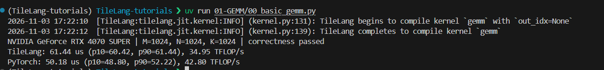
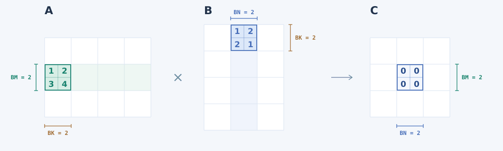
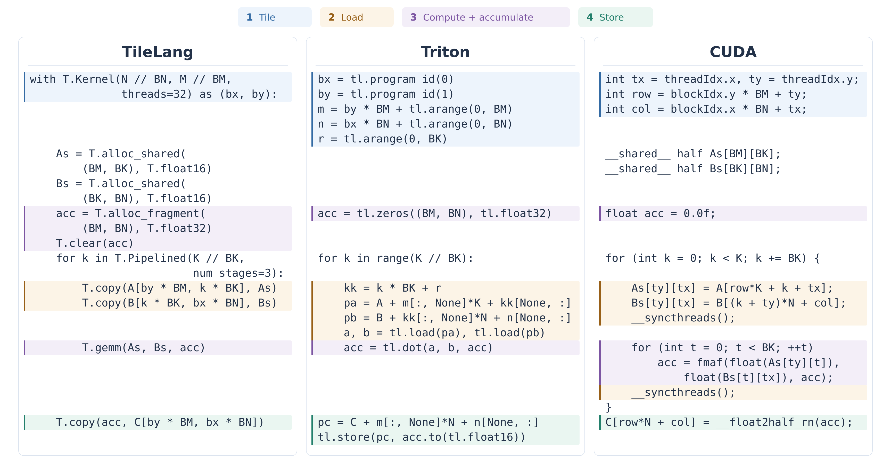
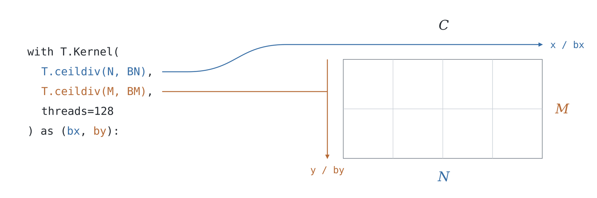
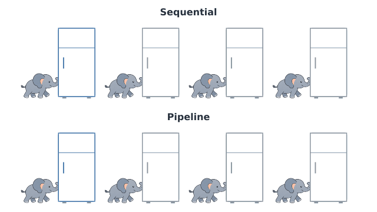

# Efficient GEMM with TileLang


## Introduction

In our earlier CUDA tutorials, we explored several ways to make GEMM faster, such as **shared memory**, **Tensor Cores**, and **pipelines**.

Unfortunately, writing CUDA kernels has a way of getting pretty involved.
The core computation often takes just a few lines of code. 
But once we've dealt with **thread mapping, data movement, and synchronization**, those few lines can be hard to spot.

<p align="center">
  
</p>

**By hand, we might spend all night getting a kernel to work. With vibe coding, we might have it working in minutes and spend all night figuring out how it works.**

<p align="center">
  
</p>

We'd like a kernel that's easier to write and easier to follow. 
So, ***TileLang*** lets us work with whole tiles while the compiler handles much of the thread mapping. We'll revisit GEMM with the example in [`00_basic_gemm.py`](00_basic_gemm.py).


## 1. Taking It for a Spin

Before we get into the code, let's see it in action. With the [environment set up](../README.md#quick-start), we can run this from the project root.

```bash
uv run 01-GEMM/00_basic_gemm.py
```

The first run may take a moment while TileLang compiles the kernel.    
If all goes well, we'll see **`correctness passed`**, followed by timings for TileLang and PyTorch.



And there we go!   
Our first TileLang kernel is up and running.

This screenshot was captured on an `NVIDIA GeForce RTX 4070 SUPER`, with `M = N = K = 1024`. The TileLang kernel takes 61.44 μs, while PyTorch's `torch.mm` takes 50.18 μs.   
All right, it looks like PyTorch wins this round. 
The TileLang kernel takes about 22% longer in this test.

Those timings give us a starting point. We can also try a smaller case that's easier to follow, then an uneven shape to check the tile boundaries.

```bash
# Smaller matrices
uv run 01-GEMM/00_basic_gemm.py --shape 128 128 128

# Partial tiles in all three dimensions
uv run 01-GEMM/00_basic_gemm.py --shape 129 257 259
```

If you'd like a peek under the hood, `--source` prints the CUDA code TileLang generates.

```bash
uv run 01-GEMM/00_basic_gemm.py --source
```


## 2. Math and Code

We’ve seen it run. Now let’s take a look under the hood, starting with some familiar math.

$$
C_{M\times N}=A_{M\times K}B_{K\times N}.
$$

Each element of the `M × N` output is a sum of `K` products. We store `A`, `B`, and `C` in FP16 and accumulate in FP32 to keep rounding error in check.

Here’s what that looks like in TileLang.

```python
import tilelang
import tilelang.language as T


@tilelang.jit
def gemm(A, B, C, BM=128, BN=128, BK=32):
    M, N, K = T.const("M, N, K")
    A: T.Tensor((M, K), T.float16)
    B: T.Tensor((K, N), T.float16)
    C: T.Tensor((M, N), T.float16)

    with T.Kernel(T.ceildiv(N, BN), T.ceildiv(M, BM), threads=128) as (bx, by):
        A_shared = T.alloc_shared((BM, BK), T.float16)
        B_shared = T.alloc_shared((BK, BN), T.float16)
        C_acc = T.alloc_fragment((BM, BN), T.float32)
        T.clear(C_acc)
        for k in T.Pipelined(T.ceildiv(K, BK), num_stages=3):
            T.copy(A[by * BM, k * BK], A_shared)
            T.copy(B[k * BK, bx * BN], B_shared)
            T.gemm(A_shared, B_shared, C_acc)
        T.copy(C_acc, C[by * BM, bx * BN])
```


## 3. A Template to Build On

We’ll reuse these two imports in later kernels.

```python
import tilelang
import tilelang.language as T
```

`T` is our shorthand for `tilelang.language`, home to operations such as `T.copy` and `T.gemm`.

The three matrices from our equation become the arguments to `gemm`.

```python
@tilelang.jit
def gemm(A, B, C, BM=128, BN=128, BK=32):
    M, N, K = T.const("M, N, K")
    A: T.Tensor((M, K), T.float16)
    B: T.Tensor((K, N), T.float16)
    C: T.Tensor((M, N), T.float16)
```

`@tilelang.jit` marks the function for compilation into a GPU kernel. `A` and `B` are the inputs, and `C` is where the result goes.

`T.Tensor` gives each matrix a shape and dtype. For example, `A` is an `M × K` matrix of FP16 values.

`T.const` declares `M`, `N`, and `K` as compile-time constants. The equation can get away with letters. The compiler needs actual numbers, which we supply from Python.

```python
kernel = gemm.compile(M=M, N=N, K=K)
```

The values on the right are Python integers. `.compile()` returns a callable kernel that we’ll run with our tensors later.

That sets the full matrix dimensions. The kernel works on smaller tiles, whose sizes come from `BM`, `BN`, and `BK`.

| Parameter | Meaning | Default |
| --- | --- | ---: |
| `BM` | Rows in one output tile | 128 |
| `BN` | Columns in one output tile | 128 |
| `BK` | Step size along `K` | 32 |

The defaults give us `128 × 128` output tiles, with `32` positions along `K` processed per iteration.



The animation uses `BM = BN = BK = 2` to keep the numbers readable. The output tile stays put while matching tiles from `A` and `B` move along `K`. Each pair’s product adds to the same running sum. There’s our sum of products again, this time in chunks.


## 4. Inside the Kernel

We’ve chosen our tile sizes. Now let’s break the kernel’s work down into four steps.

1. **Divide the work into tiles.**
2. **Load the inputs.**
3. **Compute and accumulate.**
4. **Store the result.** 

Here’s what those four steps look like in TileLang, Triton, and CUDA.



Back in our TileLang kernel, the order might look backward at first. A matrix shape lists rows before columns, while the GPU’s launch grid uses `(x, y)`. 

Here, x runs across the `N` columns and y runs down the `M` rows. That’s why `T.ceildiv(N, BN)` comes before `T.ceildiv(M, BM)`.




One more thing, `threads=128` gives each block 128 threads or four warps on NVIDIA GPUs. TileLang determines how the tile’s values and operations are distributed across them.

---

OK, let's give it some space for the input tiles and partial sums.  
Before the loop, we need to initialize these sums to zero with `T.clear(C_acc)`.   
`T.alloc_shared` keeps the inputs in shared memory.    
`T.alloc_fragment` keeps the partial sums in registers.   
For both calls, we pass the tile shape and element type.
The input buffers need no clearing, as `T.copy` overwrites them on each iteration.  

```python
A_shared = T.alloc_shared((BM, BK), T.float16)
B_shared = T.alloc_shared((BK, BN), T.float16)
C_acc = T.alloc_fragment((BM, BN), T.float32)
T.clear(C_acc)
```


---


All set. But it seems that these matrices aren't going to multiply themselves.   
Let's go on, load two input tiles, multiply them, and add the product to `C_acc`.

```python
for k in T.Pipelined(T.ceildiv(K, BK), num_stages=3):
    T.copy(A[by * BM, k * BK], A_shared)
    T.copy(B[k * BK, bx * BN], B_shared)
    T.gemm(A_shared, B_shared, C_acc)
```

`k` is the tile index along `K`, and `k * BK` gives the starting position for each pair. With `K = 1024` and `BK = 32`, we process 32 pairs of input tiles, all contributing to the same `C_acc`.

Do you remember that old joke about putting an elephant in a fridge? Unfortunately, this time we've got 100 elephants waiting. With a fridge for each elephant and three people sharing the work, one person can open the next door while another puts an elephant in and the third closes the previous door. That's the idea behind pipelining.



Back in GEMM, our jobs are fetching tiles and multiplying them. `T.copy` brings in a pair of tiles, `A_k` and `B_k`, and `T.gemm` adds their product to the same accumulator.

`T.Pipelined` asks TileLang to fetch later pairs while computing with the current pair.    
Here, `num_stages=3` requests three input-buffer slots to rotate through. One pair can be in use while the others are ready or still loading. These slots hold different batches of inputs. 

---

After the loop, `C_acc` holds the finished output tile. One last copy writes it to `C` and converts the sums from FP32 to FP16.

```python
T.copy(C_acc, C[by * BM, bx * BN])
```


## 5. Run, Check, and Measure

Back in Python, we can give our kernel and PyTorch the same random matrices. A second opinion never hurts.

```python
torch.manual_seed(0)
# Disable reduced-precision reductions for the reference.
torch.backends.cuda.matmul.allow_fp16_reduced_precision_reduction = False
a = torch.randn((M, K), device="cuda", dtype=torch.float16)
b = torch.randn((K, N), device="cuda", dtype=torch.float16)
c = torch.empty((M, N), device="cuda", dtype=torch.float16)
ref = torch.empty_like(c)

kernel = gemm.compile(M=M, N=N, K=K)
kernel(a, b, c)
torch.mm(a, b, out=ref)
torch.testing.assert_close(c, ref, rtol=1e-2, atol=1e-2)
```

Small rounding differences are normal, and `assert_close` allows for them within the chosen tolerance.

Once the check passes, we can see how the timings compare. Both calls reuse their buffers, with compilation and allocation already out of the way.

```python
for name, fn in (
    ("TileLang", lambda: kernel(a, b, c)),
    ("PyTorch", lambda: torch.mm(a, b, out=ref)),
):
    p10_ms, median_ms, p90_ms = do_bench(
        fn, backend="event", quantiles=[0.1, 0.5, 0.9]
    )
    tflops = 2 * M * N * K / median_ms / 1e9
```

`do_bench` takes care of warmup and repeated runs. We report the median, with p10 and p90 showing the variation. Its [Event backend](https://github.com/tile-ai/tilelang/blob/v0.1.13/tilelang/profiler/bench.py) flushes L2 before each timed call for both implementations.
