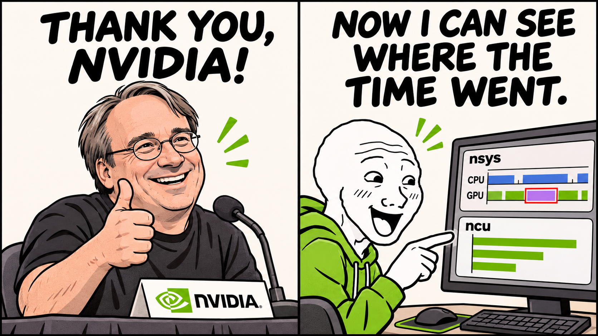
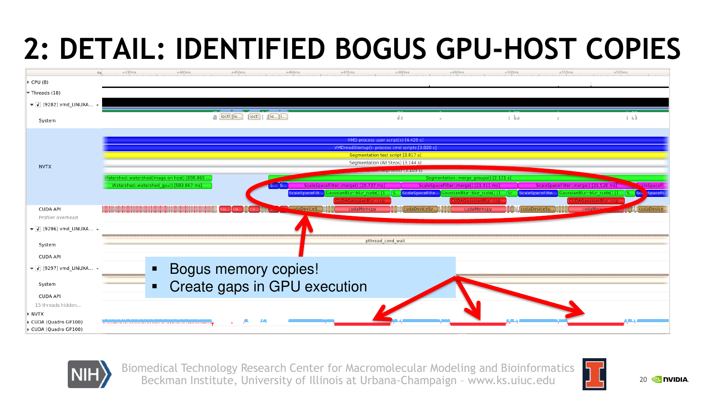
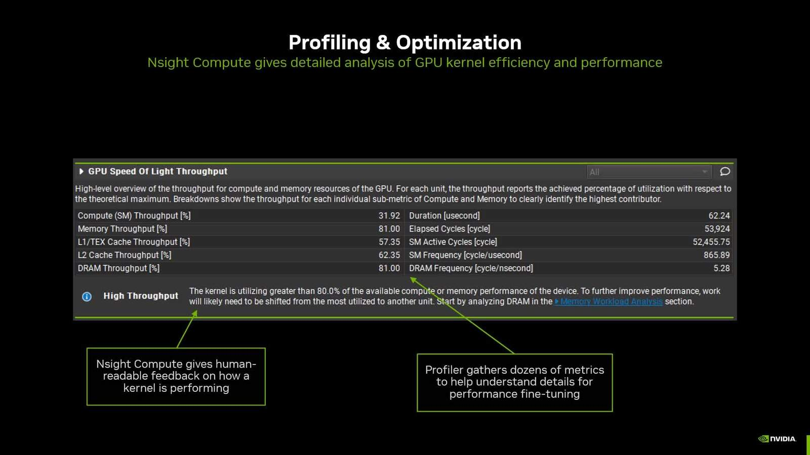
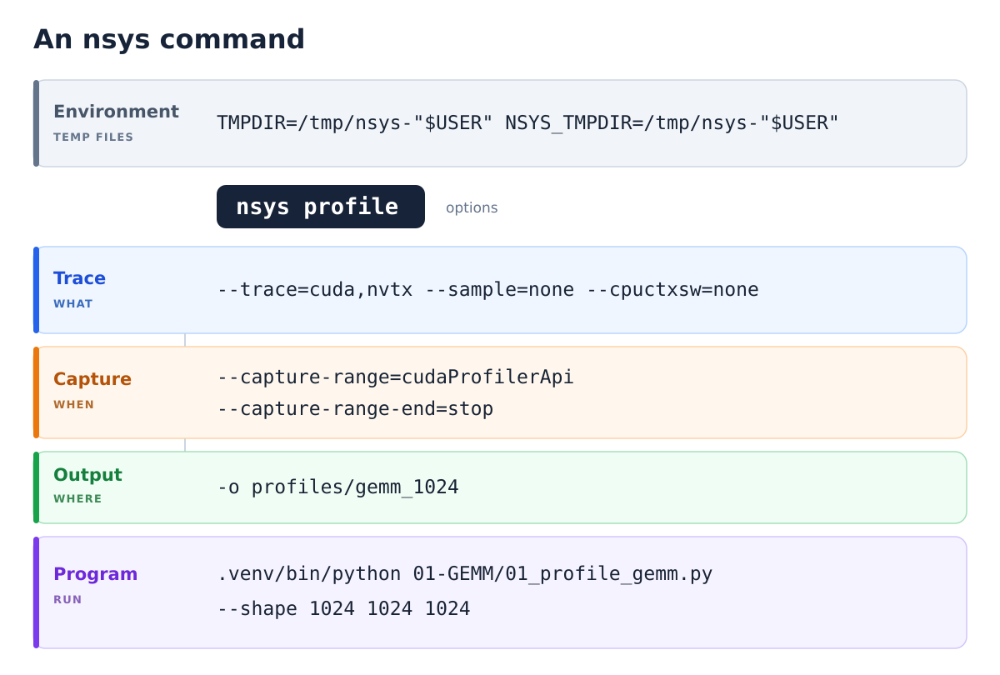
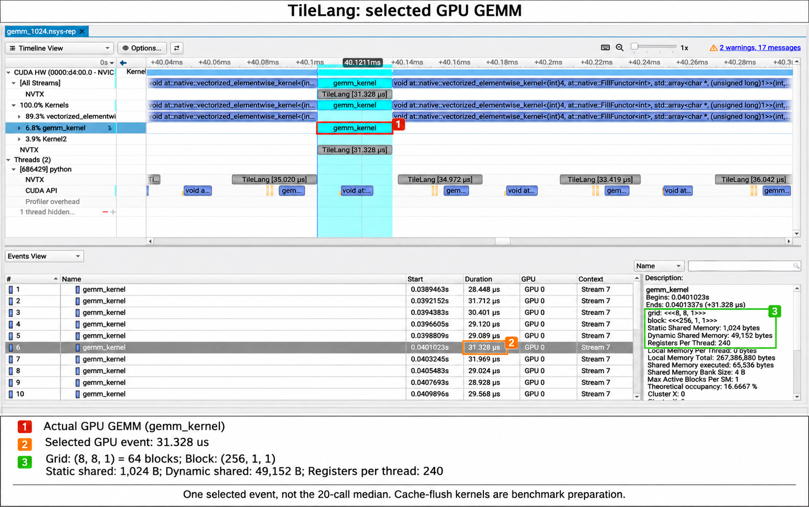
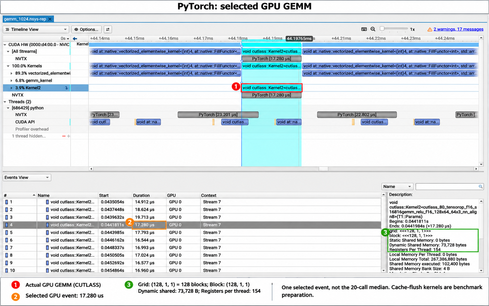

# Mind the GEMM Gap

In the [previous lesson](00-basic-gemm.md), we got our first TileLang GEMM up and running. PyTorch came out ahead in the benchmark.

All right, let's find out where we're losing time.

Our kernel already uses shared memory, Tensor Cores, and a pipeline. Before we change the code, let's see how those pieces are working together.

## 1. Meet the Profilers

NVIDIA gives us two tools for the job:

| [Nsight Systems](https://developer.nvidia.com/nsight-systems) (`nsys`) | [Nsight Compute](https://developer.nvidia.com/nsight-compute) (`ncu`) |
| :---: | :---: |
|  |  |
| **Where does the time go?** See CPU work, GPU kernels, memory copies, and the gaps between them on one timeline. | **What's holding this kernel back?** Look inside a kernel: memory traffic, compute activity, and what makes threads wait. |

Both tools arrived in 2018: [Nsight Systems](https://developer.nvidia.com/blog/nsight-systems-exposes-gpu-optimization/) in the spring, then [Nsight Compute 1.0](https://developer.nvidia.com/nsight-compute-history) with CUDA 10.0 in September. We'll start with the whole program, then zoom in on one kernel.

<p align="center">
  
</p>

`nsys` is handy for catching work we didn't mean to do. **John Stone** and his team ran into this while speeding up VMD, a molecular visualization tool. They found extra CPU/GPU transfers that left gaps between kernels. Their [case study](https://www.ks.uiuc.edu/Research/gpu/files/S8718-Robert-Knight-John-Stone.pdf#page=37) describes how Nsight Systems “helped identify unintentional copies.”

<p align="center">
  
</p>

*John Stone and colleagues, [VMD profiling case study, slide 20](https://www.ks.uiuc.edu/Research/gpu/files/S8718-Robert-Knight-John-Stone.pdf#page=20).*

`ncu` picks up from there. Once we've found a kernel to look at, we can check what's keeping it busy or making it wait. The report explains the metrics and suggests where to look next. CUDA architect **Stephen Jones** walks us through an example in [this talk](https://www.nvidia.com/en-us/on-demand/session/gtcspring23-S51210/), calling it “human readable analysis of what your program is doing.”

<p align="center">
  
</p>

*Stephen Jones, [How to Write a CUDA Program](https://www.nvidia.com/en-us/on-demand/session/gtcspring23-S51210/), profiling section.*

## 2. Get the Tools Ready

We'll collect the data on the GPU server and read the reports on our own computer. Your laptop doesn't need an NVIDIA GPU to open a report.

Both tools have desktop apps for Windows, macOS, and Linux. Copy the report over and open it in the matching app.

<details>
<summary>Install the tools</summary>

You can skip this bit if compatible versions of `nsys` and `ncu` are already installed.

Grab the Linux installers for [Nsight Systems](https://developer.nvidia.com/nsight-systems/get-started) and [Nsight Compute](https://developer.nvidia.com/tools-overview/nsight-compute/get-started). Pick versions that support your GPU and driver. On Ubuntu, run these commands from the download folder:

```bash
sudo apt install ./nsight-systems-*.deb
sudo bash ./nsight_compute-linux-*.run
```

Installing the tools requires sudo. For your own computer, get the desktop apps for your OS from the same pages. The `nsys` viewer should be the [same version or newer](https://docs.nvidia.com/nsight-systems/UserGuide/index.html#sharing-a-report-file) than the server's collector.

</details>

## 3. Start with nsys

Let's run our GEMM through `nsys`. We put the profiler in front of the Python command and tell it what to record. Run this from the project root on the GPU server:

```bash
# Make room for the report and nsys's temporary files.
mkdir -p profiles /tmp/nsys-"$USER"

TMPDIR=/tmp/nsys-"$USER" NSYS_TMPDIR=/tmp/nsys-"$USER" \
nsys profile \
  --trace=cuda,nvtx --sample=none --cpuctxsw=none \
  --capture-range=cudaProfilerApi --capture-range-end=stop \
  -o profiles/gemm_1024 \
  .venv/bin/python 01-GEMM/01_profile_gemm.py --shape 1024 1024 1024
```

<p align="center">
  
</p>

For now, let's focus on **Trace** and **Capture**.

**Trace chooses what we record.** `cuda` records CUDA calls and GPU work; `nvtx` adds our `TileLang` and `PyTorch` labels. Those are the names to look for on the timeline.

> To see where CPU time goes, `--sample` periodically checks which code is running. To see when threads get CPU time, `--cpuctxsw` records when they are scheduled in or switched out.
>
> For our GEMM comparison, let's keep both at `none`. CUDA events and NVTX labels are still recorded.

**Capture chooses when we record.** Our [script](01_profile_gemm.py) uses the same GEMM as last time. It checks the result against PyTorch and warms up both versions first. The `cudaProfilerApi` option lets it start recording after that setup: **20 calls to each implementation**, and then stop.

You'll find the report at `profiles/gemm_1024.nsys-rep`. Download the report, then double-click it.


## 4. Find Our GEMM

The timeline has a lot of colored bars. Let's pick out one GEMM call.

Find a `TileLang` or `PyTorch` label, then click the GPU kernel launched by that call under **CUDA HW**. In the screenshots, red **1** marks the GPU event, orange **2** its duration, and green **3** its launch details.





Keep an eye on the GPU event's **Duration**. If Description says **Kernel launcher**, you've clicked a CPU launch call. Move to the GPU event to read the execution time. The gray CPU/NVTX ranges mark our Python calls; the GPU row shows the work they launch.

Those long `FillFunctor<int>` bars are our cache flushes. We added them before each GEMM to match the benchmark's cache preparation. They account for **89.3% of all recorded kernel time** in this capture, including the buffer clearing. Use the labeled GEMM events for our comparison. The same launch can appear in several timeline rows. Count that event once.

The selected calls take **31.328 µs** and **17.280 µs**. The screenshots use different zoom levels. Read the duration values when comparing them. For a better picture of the gap, let's use all 20 calls:

```bash
nsys stats --report nvtx_kern_sum profiles/gemm_1024.nsys-rep
```

Here's what we get:

| | TileLang | PyTorch |
| --- | ---: | ---: |
| GEMM kernels per call | 1 | 1 |
| Median GPU duration | 29.26 µs | 16.98 µs |

This run uses an **RTX 5090 D v2** with `M=N=K=1024`. The first lesson's screenshot came from a 4070 SUPER. Those earlier timings belong to a different experiment.

We've found a useful clue: **the gap shows up on the GPU**. TileLang's kernel takes about 72% longer here. CPU submission costs may add to the full call's time, but we already have a difference inside the kernel to investigate.

Another trace might send us elsewhere. Extra kernels would give us more work to account for; gaps might lead us to submission or dependencies. This time, we can follow the slower GEMM kernel.

## 5. A Clue in the Grid

Let's start with **Grid** on the right. TileLang launches `(8,8,1)`: just **64 blocks**. PyTorch launches **128**. Our GPU has **170 SMs**.

We chose `128×128` output tiles in the first lesson. For a `1024×1024` output, that's only `8×8` blocks. We haven't given the GPU enough independent blocks to put work on every SM at once.

**Let's try a smaller output tile and see whether the extra blocks help.** Larger tiles reuse more inputs and do more work per block. Shrinking the tile changes both parallelism and reuse. We'll need to time the result.

There's more to check in the same panel:

- **Registers per thread: 240 versus 154.** Our FP32 accumulator and temporary values need registers. We need to check whether that count actually limits the kernel or causes spills.
- **Static + dynamic shared memory: 49 versus 72 KiB per block.** PyTorch uses more and still finishes sooner. We'll judge changes to the buffering by what they do to the timing.
- **Block: 256 versus 128 threads.** Our `threads=128` request became a 256-thread kernel with separate loading and computing groups. Run the first lesson with `--source` to see what the compiler produced.

The `C_acc`, `A_shared`, and `B_shared` buffers from the first lesson now show up as resource use in the profile. We can start connecting our code to what the GPU actually runs.

**Time to bring in Nsight Compute (`ncu`).** We've found the slower kernel and a parameter to test. Start with a few sections:

1. **Launch Statistics + Occupancy:** check the grid and how many blocks can fit on an SM.
2. **Compute/Memory Workload Analysis:** see which compute or memory pipelines are busy.
3. **Scheduler Statistics:** check whether warps have instructions ready to issue.

NVIDIA's [kernel diagnosis guide](https://docs.nvidia.com/nsight-compute/ComputeTriage/index.html) walks through this approach. We can collect more detail as we need it. A single percentage won't pick the best configuration for us.

## 6. Try a Smaller Tile

Let's give **`BN=64`** a go. Keep `BM`, `BK`, and the pipeline as they are, and use a separate runner or a copy of the kernel.

```python
candidate = gemm.compile(M=1024, N=1024, K=1024, BN=64)
```

That takes us from 64 output blocks to 128. Reuse and accumulator size change as well. We'll keep those effects in mind when reading the results.

Check the answer again, then rerun the first lesson's Event benchmark with the same precision and cache preparation. **Use the benchmark to check the speedup, and the profiler to work out why.**

That change helped. Next, we kept `BN=64` and tried `BK=64`. This cuts the number of K steps in half and makes each buffered tile larger. Another tradeoff to test.

Here are the medians from five runs of the independent Event benchmark on the same GPU. Keep these separate from the `nsys` durations above: the two methods time different intervals.

| Trial | Event latency |
| --- | ---: |
| Original: `BM=128, BN=128, BK=32` | 32.000 µs |
| Change only `BN` to `64` | 21.760 µs |
| Then change `BK` to `64`, keeping `BN=64` | 19.712 µs |

We ran the tests from copies and left the original lesson file as it was.

One result is worth a second look. A `64×64` output tile with `BK=32` gave us 256 blocks, but took 27.872 µs. More blocks didn't keep making it faster. The reported register count also stayed at 240 in the faster candidates.

The smaller output tile and larger reduction step made this case about **1.62× faster**. We've found better settings for this workload. We still haven't measured how much of the gain comes from parallelism, reuse, or compiler scheduling individually.

Before changing the defaults, give other matrix sizes a try. A fast result at `1024³` is a good start, and we'll check how it holds up elsewhere.

## 7. Keep Going

We tried a few more combinations and found another candidate: **`BM=BN=BK=64`, source-level `threads=64`, three stages, and warp specialization disabled**. The compiler now produces a 64-thread kernel with `cp.async` loading. This experiment changes the thread setup and loading path too; it goes beyond the tile-size change above.

```python
@tilelang.jit(pass_configs={"tl.disable_warp_specialized": True})
def gemm(A, B, C, BM=64, BN=64, BK=64):
    # Keep the kernel body, but request threads=64 and retain num_stages=3.
    ...
```

Five rounds of the same Event benchmark gave **18.432 µs**, down from 19.712 µs. That's another **6.5% off the latency**. The results passed our correctness check with three random seeds. We also checked that the saved candidate only needed the one compiler flag shown above.

Before we say we're close to the hardware limit, we need the right peak to compare against. We're doing **dense FP16 multiplication with FP32 accumulation**. AI TOPS, sparse rates, and lower-precision rates describe different work. Appendix A of NVIDIA's [Blackwell architecture paper](https://images.nvidia.com/aem-dam/Solutions/geforce/blackwell/nvidia-rtx-blackwell-gpu-architecture.pdf) lists these paths separately.

Here's a rough starting point from the public GB202 rates: `170 SMs × 512 FLOP/SM/cycle × SM clock`. At 2.55 GHz, that's about **222 TFLOP/s**. The `2.147 GFLOP` in `1024³` would take **9.68 µs** if we counted only ideal computation.

Real kernels still have to load data, schedule work, and fill the pipeline. This estimate uses public GB202 rates; it isn't a measured peak for this particular card. Check the clock it actually ran at, too. An advertised maximum boost clock won't tell us that.

There's a catch with memory, too. Reading A and B once and writing C once adds up to **6 MiB of logical matrix I/O**. Our NCU report saw about **4.21 MB of DRAM reads and zero DRAM writes during the selected kernels**. The output stores can stay in cache until later. To work out bandwidth use, read the traffic counters at each memory level. NVIDIA's [hierarchical roofline guide](https://docs.nvidia.com/nsight-compute/ProfilingGuide/index.html#roofline-charts) explains how to do that.

Here are the medians from three launches per candidate, after warm-up:

| Metric | Previous candidate | Further candidate |
| --- | ---: | ---: |
| Blocks / actual threads per block | 128 / 256 | 256 / 64 |
| Tensor activity over elapsed cycles | 52.65% | 54.85% |
| Tensor activity over active cycles | 77.84% | 60.50% |
| Dynamic shared memory per block | 72 KiB | 48 KiB |
| Registers per thread, reported | 240 | 134 |
| Achieved occupancy | 14.97% | 6.27% |
| L2 throughput | 45.37% | 56.93% |

Occupancy went down, and the kernel got faster. The new candidate has more blocks, fewer threads per block, and a different loading path. It also asks more of L2. Together, these settings worked better here. We can't assign the whole gain to one counter.

We also tried `4096³` to see what this card could do with more work. PyTorch reached about **207 TFLOP/s**, with **89.69% Tensor activity over elapsed cycles** and **96.50% over active cycles** in NCU. Achieved occupancy was only 8.33%. The card can get much closer to sustained Tensor capacity when the workload gives it enough work.

Our new candidate fell behind the previous one at `2048³` and `4096³`. The settings that helped at `1024³` didn't win everywhere. That's a good reason to choose configurations by shape.

We ran into one tool limitation here. This card is identified as an export-control SKU, which the installed NCU Tensor Roofline section marks as unsupported. We didn't get the automatic chart or its tensor-operation counters. The peak above remains an estimate, checked against the available counters and our larger-matrix runs.

Next, we can try different `BK` and stage settings for the new loading path, look into the extra L2 traffic, and compare suitable library algorithms under the same precision and cache conditions. Getting close to a good library result is encouraging. Calling it the hardware limit takes more evidence than a handful of parameter trials.

Raw profiling reports and tuning artifacts stay local under `profiles/`.
