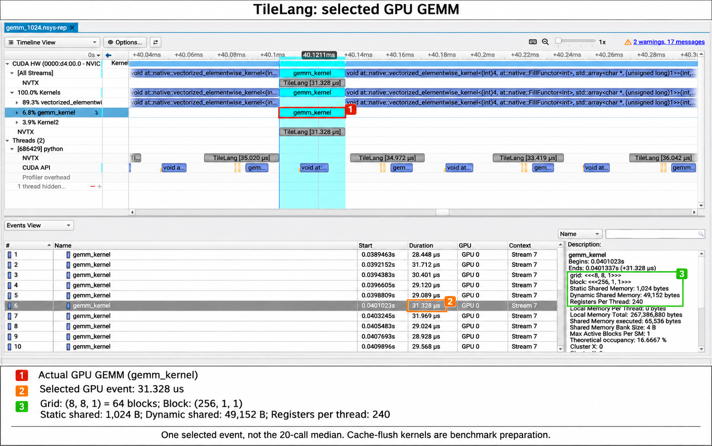
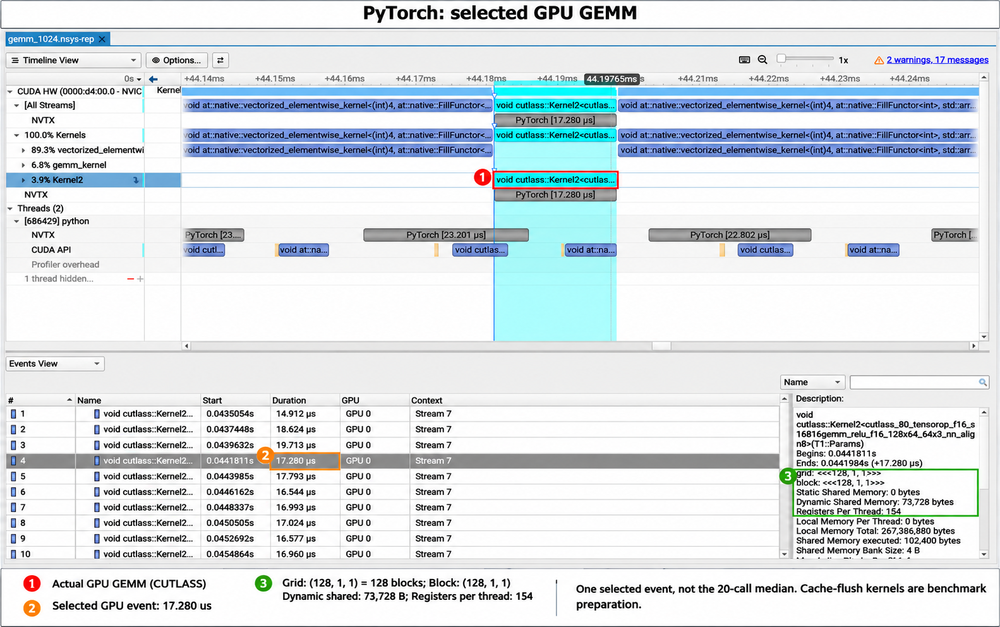
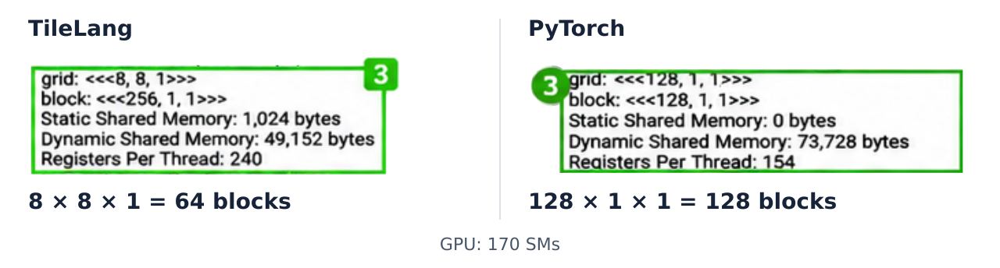
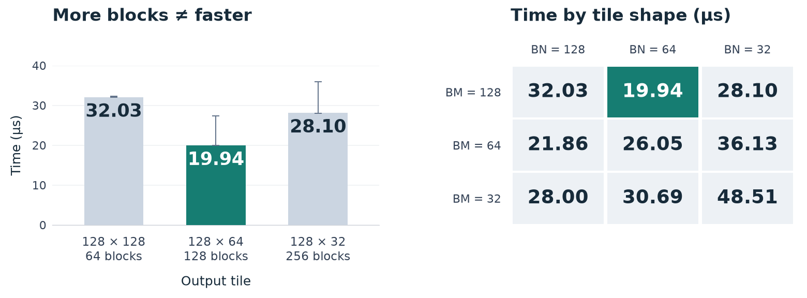

# Mind the GEMM Gap

In the [previous lesson](00-basic-gemm.md), we got our first TileLang GEMM up and running. PyTorch came out ahead in the benchmark.

All right, let's find out where we're losing time.

Our kernel already uses shared memory, Tensor Cores, and a pipeline. Before we change the code, let's see how those pieces are working together.

## 1. Meet the Profilers

NVIDIA gives us two tools for the job:

| [Nsight Systems](https://developer.nvidia.com/nsight-systems) (`nsys`) | [Nsight Compute](https://developer.nvidia.com/nsight-compute) (`ncu`) |
| :---: | :---: |
|  |  |
| **Where does the time go?** See CPU work, GPU kernels, memory copies, and the gaps between them on one timeline. | **What's holding this kernel back?** Look inside a kernel: memory traffic, compute activity, and what makes threads wait. |

Both tools arrived in 2018: [Nsight Systems](https://developer.nvidia.com/blog/nsight-systems-exposes-gpu-optimization/) in the spring, then [Nsight Compute 1.0](https://developer.nvidia.com/nsight-compute-history) with CUDA 10.0 in September. We'll start with the whole program, then zoom in on one kernel.

<p align="center">
  
</p>

`nsys` is handy for catching work we didn't mean to do. **John Stone** and his team ran into this while speeding up VMD, a molecular visualization tool. They found extra CPU/GPU transfers that left gaps between kernels. Their [case study](https://www.ks.uiuc.edu/Research/gpu/files/S8718-Robert-Knight-John-Stone.pdf#page=37) describes how Nsight Systems “helped identify unintentional copies.”

<p align="center">
  
</p>

*John Stone and colleagues, [VMD profiling case study, slide 20](https://www.ks.uiuc.edu/Research/gpu/files/S8718-Robert-Knight-John-Stone.pdf#page=20).*

`ncu` picks up from there. Once we've found a kernel to look at, we can check what's keeping it busy or making it wait. The report explains the metrics and suggests where to look next. CUDA architect **Stephen Jones** walks us through an example in [this talk](https://www.nvidia.com/en-us/on-demand/session/gtcspring23-S51210/), calling it “human readable analysis of what your program is doing.”

<p align="center">
  
</p>

*Stephen Jones, [How to Write a CUDA Program](https://www.nvidia.com/en-us/on-demand/session/gtcspring23-S51210/), profiling section.*

## 2. Get the Tools Ready

We'll collect the data on the GPU server and read the reports on our own computer. Your laptop doesn't need an NVIDIA GPU to open a report.

Both tools have desktop apps for Windows, macOS, and Linux. Copy the report over and open it in the matching app.

<details>
<summary>Install the tools</summary>

You can skip this bit if compatible versions of `nsys` and `ncu` are already installed.

Grab the Linux installers for [Nsight Systems](https://developer.nvidia.com/nsight-systems/get-started) and [Nsight Compute](https://developer.nvidia.com/tools-overview/nsight-compute/get-started). Pick versions that support your GPU and driver. On Ubuntu, run these commands from the download folder:

```bash
sudo apt install ./nsight-systems-*.deb
sudo bash ./nsight_compute-linux-*.run
```

Installing the tools requires sudo. For your own computer, get the desktop apps for your OS from the same pages. The `nsys` viewer should be the [same version or newer](https://docs.nvidia.com/nsight-systems/UserGuide/index.html#sharing-a-report-file) than the server's collector.

</details>

## 3. Start with nsys

Let's run our GEMM through `nsys`. We put the profiler in front of the Python command and tell it what to record. Run this from the project root on the GPU server:

```bash
# Make room for the report and nsys's temporary files.
mkdir -p profiles /tmp/nsys-"$USER"

TMPDIR=/tmp/nsys-"$USER" NSYS_TMPDIR=/tmp/nsys-"$USER" \
nsys profile \
  --trace=cuda,nvtx --sample=none --cpuctxsw=none \
  --capture-range=cudaProfilerApi --capture-range-end=stop \
  -o profiles/gemm_1024 \
  .venv/bin/python 01-GEMM/01_profile_gemm.py --shape 1024 1024 1024
```

<p align="center">
  
</p>

For now, let's focus on **Trace** and **Capture**.

**Trace chooses what we record.** `cuda` records CUDA calls and GPU work; `nvtx` adds our `TileLang` and `PyTorch` labels. Those are the names to look for on the timeline.

> To see where CPU time goes, `--sample` periodically checks which code is running. To see when threads get CPU time, `--cpuctxsw` records when they are scheduled in or switched out.
>
> For our GEMM comparison, let's keep both at `none`. CUDA events and NVTX labels are still recorded.

**Capture chooses when we record.** Our [script](01_profile_gemm.py) uses the same GEMM as last time. It checks the result against PyTorch and warms up both versions first. The `cudaProfilerApi` option lets it start recording after that setup: **20 calls to each implementation**, and then stop.

You'll find the report at `profiles/gemm_1024.nsys-rep`. Download the report, then double-click it.


## 4. Find Our GEMM

When you open the report, you'll see a timeline full of colored bars. Let's zoom in on one GEMM call.

Look for a `TileLang` or `PyTorch` label. Under **CUDA HW**, click the GPU kernel for that call to see its details.

The screenshots below show one call from each. Red **1** marks the kernel, orange **2** its duration, and green **3** its launch details.




Keep an eye on the GPU event's **Duration**.    
If Description says **Kernel launcher**, you've clicked a CPU launch call. Move to the GPU event to read the execution time. The gray CPU/NVTX ranges mark our Python calls; the GPU row shows the work they launch.




The TileLang kernel takes **31.328 µs** in the first screenshot, while PyTorch takes **17.280 µs** in the second.

Don't forget, compare the **Duration** numbers, not the widths of the bars!

That's just one call from each. Let's check **all 20 calls from each version**:

```bash
nsys stats --report nvtx_kern_sum profiles/gemm_1024.nsys-rep
```

Here's what we get:

| | TileLang | PyTorch |
| --- | ---: | ---: |
| GEMM kernels per call | 1 | 1 |
| Median GPU duration | 29.26 µs | 16.98 µs |

> The `FillFunctor<int>` events clear the cache before each GEMM. Leave them out when comparing the GEMM timings.

This run uses an **RTX 5090 D v2** with `M=N=K=1024`.    
And, the first lesson's screenshot came from a **4070 SUPER**. 

We've found a useful clue.
> TileLang's kernel takes about 72% longer here. 


## 5. A Clue in the Grid

Let's take a closer look at **Grid**. Here are the launch details from both screenshots, side by side:



TileLang launches `(8, 8, 1)`: **64 blocks**.    
PyTorch launches `(128, 1, 1)`: **128 blocks**.     
5090Dv2 has **170 SMs**.   
Each block runs on a single SM, leaving many SMs idle during this GEMM. 


For a fixed output, the block count follows from the tile size:
`blocks = ceil(M / BM) × ceil(N / BN)`

Our kernel uses `128×128` tiles. For a `1024×1024` output, that works out to an `8×8` grid. 

More blocks give us more independent work, but smaller tiles also change input reuse and the resources each block needs.    
We tested 9 tile shapes. On the left, `BM=128` stays fixed while `BN` changes. On the right, rows are `BM` and columns are `BN`. Green marks the lowest median in this test:



These are seven-round Event measurements; the thin lines show the range of round medians. The later tuning tables use a separate five-round run.

Going from **64 to 128 blocks** helps. Going from **128 to 256** makes it slower again. 
This balance between reuse and parallel work is also covered in [NVIDIA's GEMM guide](https://docs.nvidia.com/deeplearning/performance/dl-performance-matrix-multiplication/index.html).


### Follow the buffers into CUDA

Okay, where do those register and shared memory numbers come from?

Run the first lesson with `--source` and take a look at the CUDA code TileLang generated. Here's a snippet from our original `128×128` kernel, with the loads and math left out for now:

```cpp
extern __shared__ __align__(1024) uchar buf_dyn_shmem[];
void* A_shared = ((void*)((char*)buf_dyn_shmem + 0));
void* B_shared = ((void*)((char*)buf_dyn_shmem + 24576));
__shared__ __align__(16) uint64_t mbarrier_mem[6];
float C_acc[128];

if (threadIdx.x < 128) {
    tl::warpgroup_reg_dealloc<24>();
    // TMA loads fill A_shared and B_shared.
} else {
    tl::warpgroup_reg_alloc<240>();
    // mma_sync updates C_acc; the finished values are stored to C.
}
```

Each computing thread handles part of the output tile. Its `C_acc[128]` holds **128 FP32 running sums**.
These sums live in **registers** (the fastest storage private to each thread on the SM).    
Registers also hold input values, addresses, and temporary results. 
So, as you can see, our report lists **240 registers per thread** for the compiled kernel.

If the compiler has to save register values to memory and load them back later, that's called [**spilling**](https://docs.nvidia.com/cuda/cuda-programming-guide/02-basics/writing-cuda-kernels.html). Those extra accesses can cost time. We'll check for that traffic in ncu.

Now follow `A_shared` and `B_shared` in the code. They hold input tiles that the block's threads can reuse while computing. Both live in **shared memory**, an area on the SM that threads in the same block can access.

The loading code fills these tiles; computing threads then read the pieces they need into registers.

Each FP16 value takes two bytes. We also asked for `num_stages=3`, giving us three slots for pairs of input tiles. Here's the space they need:

```text
A: 128 × 32 × 2 bytes = 8 KiB
B:  32 × 128 × 2 bytes = 8 KiB
Three buffer slots: 3 × (8 + 8) = 48 KiB
```

Those slots let the pipeline load later tiles while computing with an earlier pair. A gets three 8 KiB slots, and B gets another three: **24 KiB each**.

Go back to the `24576` offset. That's 24 KiB in bytes. B starts there, right after A's three slots. The two regions together make up the **48 KiB** buffer named `buf_dyn_shmem[]`.

The launch supplies that buffer's size for each block. This is what **dynamic shared memory** means here. The block keeps reusing the same slots as the K loop moves on.

Loading ahead also needs a way to keep the two groups in step. Find `mbarrier_mem[6]`: it tracks when a slot is ready to read and when it's safe to refill. The computing threads wait for their inputs to arrive; the loading threads wait before overwriting inputs still in use.

The size of this six-entry array is fixed in the compiled kernel, making it **static shared memory**. Static and dynamic are two ways of reserving space in the same shared-memory pool on the SM. [NVIDIA's shared-memory example](https://developer.nvidia.com/blog/using-shared-memory-cuda-cc/) shows both forms.

The six 8-byte entries add up to 48 bytes of state. Compare that with the **1 KiB** of static memory in the report. The compiler may leave unused space to make buffers start at the required byte boundaries. That extra space is called **padding**. Our `__align__(1024)` declaration asks for a 1,024-byte boundary and can increase this padding; [NVIDIA's CCCL checks](https://nvidia.github.io/cccl/unstable/cccl/development/review_checks.html) describe the same effect. When counting how much space a block takes, use the reported 1 KiB.

There's one more piece to include: the CUDA driver reserves some shared memory for its own use. [NCU lists this separately](https://docs.nvidia.com/nsight-compute/ProfilingGuide/index.html#metrics-reference), and it's **1 KiB per block** in both captures. Add it in, and we get the comparison below. All memory sizes are in KiB:

| Per-block resource | TileLang | PyTorch |
| --- | ---: | ---: |
| Threads | 256 | 128 |
| Reported registers per thread | 240 | 154 |
| Static shared memory | 1 KiB | 0 KiB |
| Dynamic shared memory | 48 KiB | 72 KiB |
| Driver-reserved shared memory | 1 KiB | 1 KiB |
| Total shared-memory allocation | 50 KiB | 73 KiB |

If you're checking against the screenshot, its **49 versus 72 KiB** adds only static and dynamic memory. Including the driver's 1 KiB brings those totals to **50 and 73 KiB**.

One line in that table may look odd: **256 threads**, even though we wrote `threads=128`. Look back at `if (threadIdx.x < 128)`. Threads 0–127 load inputs; threads 128–255 do the math. In this kernel, the compiler added a loading group alongside our computing group.

That **Block Size** field counts threads in the block. It doesn't count the output values they produce. With 32 threads per warp, our launch has **four loading warps and four computing warps**.

Notice the register helpers in those two branches too. The loading threads request a budget of **24 registers per thread**; the computing threads request **240**. TileLang turns these helpers into PTX [setmaxnreg](https://docs.nvidia.com/cuda/parallel-thread-execution/index.html#miscellaneous-instructions-setmaxnreg) instructions. A register budget covers more than the running sums, including inputs and temporary values. The report's 240 isn't a count of accumulator values held by every thread.

The four computing warps execute the matrix multiplies. Occupancy also counts resident warps waiting for inputs or synchronization. Keep those different jobs in mind when comparing occupancy percentages.

### Turn a resource count into a test

The counts become useful when we connect them to a capacity limit. For example, NCU reports a **64 KiB shared-memory configuration per SM** for the original launch. Each block consumes **50 KiB**, which allows at most one block at a time on an SM from that memory budget.

The selected PyTorch launch has a **100 KiB configuration per SM**. Two of its 73 KiB blocks wouldn't fit either. Both launches have the same one-block bound from shared memory, even though their per-block allocations differ.

With `BN=64`, the block's total falls to **38 KiB**, while the reported configuration stays at 64 KiB. Two blocks would need 76 KiB. **The shared-memory bound is still one block per SM.** Saving 12 KiB hasn't changed that bound.

Changing `BN` also doubles the grid from 64 to 128 blocks. That gives the GPU more independent work across SMs. In our earlier five-round tuning run, Event latency falls from **32.000 to 21.760 µs**. The corresponding NCU captures show Tensor activity over elapsed cycles rising from **29.68% to 51.43%**, while achieved occupancy stays near **15.5%**. More SMs can have work even when the resident-warp percentage on active SMs barely changes.

The reported register count stays at **240**, and spilling requests stay at **zero**. We can rule out reduced spill traffic as the explanation for that gain. The counters support the parallelism hypothesis; the tile change also affects input reuse and buffering.

Use that same process for the next change:

| Suspected limit | Evidence to look for in NCU | A focused experiment |
| --- | --- | --- |
| Register spills add costly accesses | Local/shared spilling requests and the instructions making them | Reduce accumulator or temporary storage; check whether spill traffic and latency fall |
| Shared-memory use prevents more blocks from fitting | Allocated bytes per block versus the configured bytes per SM | Change `BK` or `num_stages`; check whether residency actually changes and timing improves |
| Computing warps wait for input tiles | Low Tensor activity during active SM cycles, with waits on the compute path | Vary pipeline stages; compare Tensor activity, waits, traffic, and latency |

A high register count gives us a question to investigate. Zero spills rule out one kind of cost, but registers can still limit residency. Likewise, shared memory can improve reuse and overlap while taking space away from other blocks. NVIDIA's [occupancy guidance](https://docs.nvidia.com/cuda/cuda-c-best-practices-guide/index.html#occupancy) discusses this tradeoff.

<details>
<summary>A fixed-grid example: more pipeline buffers</summary>

In the earlier five-round tuning run, we held `BM=128, BN=64, BK=64` and the thread request fixed. Only `num_stages` changed:

| Stages | A/B staging-buffer size from the code | Event median |
| --- | ---: | ---: |
| 2 | 48 KiB | 21.696 µs |
| 3 | 72 KiB | 19.712 µs |
| 4 | 96 KiB | 19.712 µs |

The grid stays at 128 blocks. Three stages use more buffer space than two and give a lower measured latency. A fourth stage spends more space without improving this run's median. These values show how to choose a setting by its measured result, rather than aiming for the smallest allocation or the deepest pipeline.

</details>

**Keep a change when it passes the correctness check and repeated timing improves beyond the usual variation.** Use the source and counters to explain which cost changed or which hypothesis the results rule out. The counters don't have to move in the same direction.

Next, use Nsight Compute (`ncu`) to compare the full reports. We have specific questions to check: spills, residency limits, and whether the computing warps have work ready.

## 6. Read the NCU Report

Start with a warmed-up GEMM call. Keep the cache-clearing kernels out of the selection, just as we did in `nsys`.

<details>
<summary>Collect a baseline report</summary>

Run this from the project root. Use the path to your installed `ncu`; here's ours:

```bash
/opt/nvidia/nsight-compute/2026.3.1/ncu \
  --config-file off \
  --profile-from-start off --nvtx --nvtx-include 'TileLang/' \
  --launch-count 3 \
  --replay-mode kernel --cache-control all --clock-control none \
  --section SpeedOfLight --section LaunchStats --section Occupancy \
  --section ComputeWorkloadAnalysis --section MemoryWorkloadAnalysis_Tables \
  --export profiles/gemm_1024_ncu \
  .venv/bin/python 01-GEMM/01_profile_gemm.py --shape 1024 1024 1024
```

`--profile-from-start off` skips the setup before the script starts profiling. `--nvtx-include 'TileLang/'` selects our TileLang calls; `--launch-count 3` collects three of them. The trailing `/` matches the push/pop NVTX ranges used by our script.

This profiles the original kernel. To profile a candidate, make a copy of the capture script beside it in `01-GEMM/`, change that copy's `gemm.compile(...)` arguments, and run it with a different report name. Keep the checks, warm-up, and cache preparation.

Our installation writes a `.ncu-repz` report; other versions may use `.ncu-rep`. Download it, then double-click it to open it in Nsight Compute.

</details>

Open the original report first. On its **Details** page, choose **Compare → Add Baseline**. After profiling a candidate, open its report in the same Nsight Compute window and switch to that result to compare the values. NVIDIA's [report comparison guide](https://docs.nvidia.com/nsight-compute/NsightCompute/index.html#baselines) shows this workflow.

For this GEMM, start with these fields:

| Look at | Where to find it | What to check |
| --- | --- | --- |
| Grid Size and Block Size | Launch Statistics | How much independent work did we launch? What thread count did the compiler actually use? |
| Tensor pipeline activity | Compute Workload Analysis | How busy was the pipeline doing our matrix multiplies? |
| DRAM and L2 throughput | Memory Workload Analysis | Is either memory level close to its throughput limit? |
| Registers, shared memory, and spilling | Launch Statistics; Memory Workload Analysis | What does each block need? Did register values spill into memory? |
| Achieved Occupancy | Occupancy | How many warps were resident on an SM, relative to its limit? |

NVIDIA's [section reference](https://docs.nvidia.com/nsight-compute/ProfilingGuide/index.html#sections-and-rules) describes these panels. Here's how we'll use them.

**Read Tensor activity over elapsed cycles first.** In **Compute Workload Analysis**, find **Tensor (All)** under **Aggregate Pipe Utilization (% of elapsed cycles)**. This includes the full kernel interval, including cycles when SMs have no work. The active-cycle chart only counts cycles when the SM is active. Both are normalized to the counter's sustained peak; neither directly measures our fraction of peak FP16 FLOP/s.

Our original kernel shows **29.68% over elapsed cycles**, versus **82.98% over active cycles**. The Tensor pipeline is much busier during active periods. Alongside the 64-block grid, that gives us a reason to try spreading the work across more SMs. It still doesn't tell us exactly how much time that change will save.

**Read DRAM and L2 separately.** The original reports **10.16% DRAM throughput** and **17.40% L2 throughput**. Neither is close to its reported peak here. There's no evidence that we're filling either level's bandwidth. Waiting for data can still cost time even when bandwidth use is low.

After a change, check the traffic counts too. A higher throughput percentage may come from moving more bytes, finishing sooner, or both. It doesn't automatically mean better reuse.

**Read resource use alongside occupancy.** Registers and shared memory can limit how many blocks fit on an SM. Spilling tells us whether values were moved out of registers into memory. Our original reports **240 registers per thread**, but **zero local and shared spilling requests**. That gives us no spill traffic to remove in this capture.

Achieved occupancy counts resident warps relative to the SM's warp limit. It doesn't tell us what fraction of the GPU's SMs had work, or how busy the Tensor pipeline was. We'll check it alongside timing and pipeline activity.

Here's how those counters connect to the settings in `00`:

| Setting | What it changes | What to watch |
| --- | --- | --- |
| `BM`, `BN` | Output tile, block count, input reuse, accumulator size | Grid, Tensor activity, registers, L2 traffic |
| `BK` | K-loop steps and input tile sizes | Timing, Tensor activity, shared memory |
| `num_stages` | How many input batches the pipeline can buffer | Timing, Tensor activity, shared memory |
| `threads` | How work is distributed within a block | Actual block size, registers, occupancy |

Change one setting at a time while building an explanation. Check the generated code when a change also makes the compiler choose a different loading or compute path.

<details>
<summary>Find the same counters in the Raw page or a CSV export</summary>

These are the names in our reports:

| Counter | Metric name |
| --- | --- |
| Tensor activity, elapsed cycles | `sm__pipe_tensor_cycles_active.avg.pct_of_peak_sustained_elapsed` |
| Tensor activity, active cycles | `sm__pipe_tensor_cycles_active.avg.pct_of_peak_sustained_active` |
| DRAM throughput | `gpu__dram_throughput.avg.pct_of_peak_sustained_elapsed` |
| L2 throughput | `lts__throughput.avg.pct_of_peak_sustained_elapsed` |
| Achieved occupancy | `sm__warps_active.avg.pct_of_peak_sustained_active` |
| Spilling requests | `derived__local_spilling_requests`, `derived__shared_spilling_requests` |

Available counters and labels depend on the GPU and tool version. Hover over a field or open **Metric Details** to check its definition. An unavailable counter isn't a zero.

Our original report also has inconsistent static estimates: theoretical occupancy is zero and Waves Per SM is `inf`, even though the kernel ran. We leave those fields out of the analysis and use the observed launch sizes and valid counters.

</details>

> **Time each candidate with the Event benchmark.** NCU can replay kernels and control caches and clocks. Our captures use `--clock-control none`, and the sampled clocks differ between reports. Use NCU to investigate changes; use the repeated benchmark to rank them. NVIDIA explains these [timing differences](https://docs.nvidia.com/nsight-compute/ProfilingGuide/index.html#workload-durations).

## 7. Try a Smaller Tile

Back to our first idea: **`BN=64`**. Keep `BM=128`, `BK=32`, `num_stages=3`, and the source-level `threads=128` request. Use a separate runner or a copy of the kernel.

```python
candidate = gemm.compile(M=1024, N=1024, K=1024, BN=64)
```

That gives us **128 blocks instead of 64**. Each block also has a smaller accumulator and B tile. Input reuse changes too, which is why we need to measure the result.

Check the answer against PyTorch, then rerun the Event benchmark with the same shape, precision, and cache preparation. The latency drops from **32.000 µs to 21.760 µs**.

Next, keep `BN=64` and try **`BK=64`**:

```python
candidate = gemm.compile(M=1024, N=1024, K=1024, BN=64, BK=64)
```

The grid stays at 128 blocks. With `K=1024`, the K loop now has **16 steps instead of 32**. Each step loads larger input tiles, which also need more buffer space. This version reaches **19.712 µs**.

Here are the medians of five round medians. Each round uses 100 warm-up calls and 500 measured calls, with a 256 MiB cache flush before each measured GEMM:

| Configuration | Blocks | Event latency |
| --- | ---: | ---: |
| Original: `BM=128, BN=128, BK=32` | 64 | 32.000 µs |
| Change only `BN` to `64` | 128 | 21.760 µs |
| Then change `BK` to `64` | 128 | 19.712 µs |

We ran the tests from copies and kept the original lesson file unchanged. These Event timings belong to this experiment; use them together when calculating the speedup.

Now compare the NCU reports. Each value below is the median of three profiled launches:

| Metric | Original | `BN=64` | `BN=64, BK=64` |
| --- | ---: | ---: | ---: |
| Actual threads per block | 256 | 256 | 256 |
| Tensor activity, elapsed cycles | 29.68% | 51.43% | 53.10% |
| DRAM throughput | 10.16% | 19.07% | 17.39% |
| L2 throughput | 17.40% | 44.82% | 42.97% |
| Dynamic shared memory per block | 48 KiB | 36 KiB | 72 KiB |
| Registers per thread, reported | 240 | 240 | 240 |
| Achieved occupancy | 15.44% | 15.50% | 14.83% |
| Local / shared spilling requests | 0 / 0 | 0 / 0 | 0 / 0 |

Read the changes together:

- **More blocks, more Tensor activity.** Changing `BN` doubles the block count, and elapsed-cycle Tensor activity rises from 29.68% to 51.43%. This supports our parallelism hypothesis. The change also affects reuse and buffering; we haven't isolated each contribution.
- **Larger K steps need more shared memory.** Changing `BK` doubles the dynamic allocation from 36 to 72 KiB. Timing still improves. Minimizing shared memory use would have missed this configuration.
- **The speedup didn't require fewer registers or higher occupancy.** The reported register count stays at 240, spilling stays at zero, and occupancy barely changes. The same resident-warp percentage can produce very different performance.

Together, the two parameter changes make this case about **1.62× faster**. More blocks alone aren't the whole story: a `64×64` output tile with `BK=32` gives us 256 blocks but takes **27.872 µs**, slower than either `BN=64` configuration above.

## 8. Keep Going

We tried a few more combinations and found another candidate: **`BM=BN=BK=64`, source-level `threads=64`, three stages, and warp specialization disabled**. In a copy of `00`, the changes look like this:

```python
@tilelang.jit(pass_configs={"tl.disable_warp_specialized": True})
def gemm(A, B, C, BM=64, BN=64, BK=64):
    # Keep the kernel body, but request threads=64 and retain num_stages=3.
    ...
```

The generated kernel now uses **64 threads and `cp.async` loading**. This changes the thread setup and loading path as well as the tile size. Treat it as a new configuration to compare; it doesn't isolate a single cause.

Five rounds of the same Event benchmark give **18.432 µs**, down from 19.712 µs: another **6.5% off the latency**. The candidates passed our correctness check with three random seeds.

Here are the NCU results from a fresh comparison, again taking the median of three launches. The first column is the `BM=128, BN=64, BK=64` configuration from the last section:

| Metric | Previous candidate | New candidate |
| --- | ---: | ---: |
| Blocks / actual threads per block | 128 / 256 | 256 / 64 |
| Tensor activity, elapsed cycles | 52.65% | 54.85% |
| Tensor activity, active cycles | 77.84% | 60.50% |
| DRAM throughput | 19.53% | 17.97% |
| L2 throughput | 45.37% | 56.93% |
| Dynamic shared memory per block | 72 KiB | 48 KiB |
| Registers per thread, reported | 240 | 134 |
| Achieved occupancy | 14.97% | 6.27% |
| L1/TEX-to-L2 read traffic | 48 MiB | 64 MiB |

**Occupancy went down, and the kernel got faster.** There are fewer threads in each block, and the loading work is organized differently. Fewer resident warps can still do useful work efficiently. This is why we keep checking the timing instead of trying to maximize occupancy.

**The two Tensor percentages move in opposite directions.** Activity over the full kernel interval rises a little; activity during active SM cycles falls. They use different denominators. Read them alongside the grid and thread changes before claiming that the math itself became more efficient.

**The higher L2 percentage comes with more traffic.** Reads on the L1/TEX-to-L2 path rise from 48 to 64 MiB. The new configuration trades more traffic on that path for a lower measured latency. DRAM throughput is still below 20%; these captures don't show saturated DRAM bandwidth. Memory latency or another part of the memory path could still matter.

<details>
<summary>Dig into scheduler and warp waits when the first counters aren't enough</summary>

Add `--section SchedulerStats --section WarpStateStats` to the collection command for both configurations, keeping the other settings the same.

In **Scheduler Statistics**, read **Eligible Warps Per Scheduler** and **Issue Active** together. Eligible warps are ready to issue an instruction. Low issue activity alongside low Tensor activity can be a reason to investigate exposed waits.

Then use **Warp State Statistics** to investigate dependencies and synchronization. Match the waits to the loading and computing work before changing the pipeline. A loading group waiting at a barrier may be part of the intended schedule.

Low issue activity alone doesn't prove that Tensor work is starved. Our `4096³` PyTorch capture reaches **89.69% elapsed-cycle Tensor activity** with only **10.11% issue activity**. One issued matrix instruction can keep the execution pipeline working for multiple cycles.

NVIDIA's [kernel diagnosis guide](https://docs.nvidia.com/nsight-compute/ComputeTriage/index.html) goes further into these checks. A large stall count or an automatic speedup estimate still needs an experiment to show that fixing it improves our kernel.

</details>

We also checked `2048³` and `4096³`. The new candidate fell behind the previous one at both sizes. The settings that help this `1024³` GEMM don't win everywhere; choose configurations by shape.

<details>
<summary>Going further: compare against a hardware ceiling</summary>

Use the peak for **dense FP16 multiplication with FP32 accumulation**. AI TOPS, sparse rates, and other precisions describe different work. NVIDIA's [Blackwell architecture paper](https://images.nvidia.com/aem-dam/Solutions/geforce/blackwell/nvidia-rtx-blackwell-gpu-architecture.pdf) separates these paths.

The public GB202 rate gives a rough model: `170 SMs × 512 FLOP/SM/cycle × SM clock`. At 2.55 GHz, that's about **222 TFLOP/s**. The `2.147 GFLOP` in `1024³` would take **9.68 µs** under ideal computation alone. This is an architecture-based estimate for our card; it leaves out data access, scheduling, and pipeline startup and drain. Use the clock the GPU actually ran at when applying the model.

Use measured traffic for each memory level, too. Reading A and B once and writing C once adds up to **6 MiB**, but our selected kernels report about **4.21 MB of DRAM reads and zero DRAM writes** during their execution. C is still written; the stores can remain in cache until later. NVIDIA's [hierarchical roofline guide](https://docs.nvidia.com/nsight-compute/ProfilingGuide/index.html#roofline-charts) explains the memory-level comparison.

For a larger workload, PyTorch reaches about **207 TFLOP/s** at `4096³`, with **89.69% Tensor activity over elapsed cycles**, **96.50% over active cycles**, and **8.33% achieved occupancy**. That shows what this card can sustain with more work. It doesn't establish the best possible latency for `1024³`.

The installed NCU Tensor Roofline section marks this card's export-control SKU as unsupported. We didn't get its automatic chart or tensor-operation counters. The peak above remains an estimate, checked against the available counters and larger-matrix runs. Neither that estimate nor a finite set of parameter trials proves we've reached the best possible implementation.

</details>

For the next experiment, we can vary `BK` and `num_stages` on the new loading path, then check whether the extra L2 traffic can be reduced without losing parallel work. We now have both a timing method and a small set of counters to judge those changes.

Raw profiling reports and tuning artifacts stay local under `profiles/`.
