# Mind the GEMM Gap

In the [previous lesson](../00-basic-gemm/README.md), we got our first TileLang GEMM up and running. PyTorch came out ahead in the benchmark.

All right, let's find out where we're losing time.

Our kernel already uses shared memory, Tensor Cores, and a pipeline. Before we change the code, let's see how those pieces are working together.

## 1. Meet the Profilers

NVIDIA gives us two tools for the job:

| [Nsight Systems](https://developer.nvidia.com/nsight-systems) (`nsys`) | [Nsight Compute](https://developer.nvidia.com/nsight-compute) (`ncu`) |
| :---: | :---: |
|  |  |
| **Where does the time go?** See CPU work, GPU kernels, memory copies, and the gaps between them on one timeline. | **What's holding this kernel back?** Look inside a kernel: memory traffic, compute activity, and what makes threads wait. |

Both tools arrived in 2018: [Nsight Systems](https://developer.nvidia.com/blog/nsight-systems-exposes-gpu-optimization/) in the spring, then [Nsight Compute 1.0](https://developer.nvidia.com/nsight-compute-history) with CUDA 10.0 in September. We'll start with the whole program, then zoom in on one kernel.

<p align="center">
  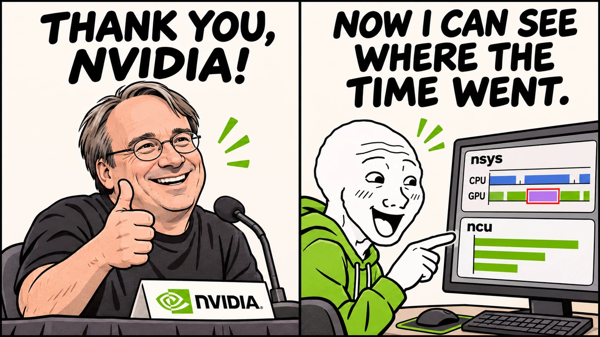
</p>

`nsys` is handy for catching work we didn't mean to do. **John Stone** and his team ran into this while speeding up VMD, a molecular visualization tool. They found extra CPU/GPU transfers that left gaps between kernels. Their [case study](https://www.ks.uiuc.edu/Research/gpu/files/S8718-Robert-Knight-John-Stone.pdf#page=37) describes how Nsight Systems “helped identify unintentional copies.”

<p align="center">
  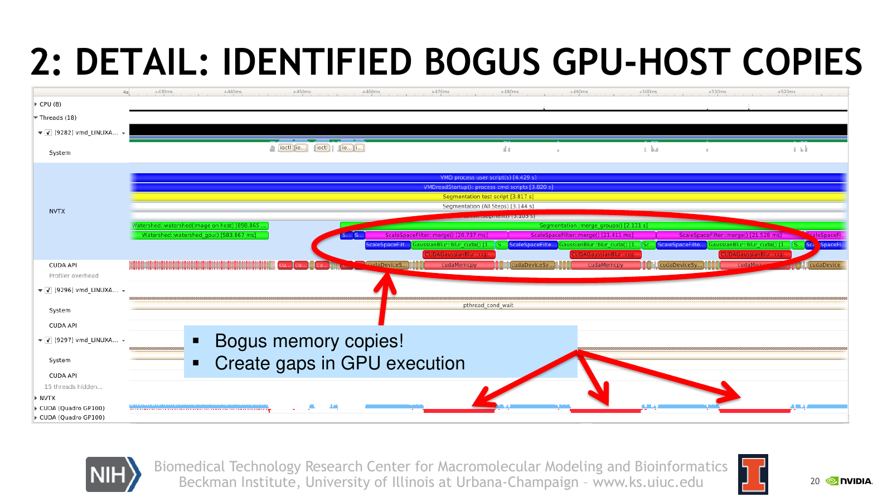
</p>

*John Stone and colleagues, [VMD profiling case study, slide 20](https://www.ks.uiuc.edu/Research/gpu/files/S8718-Robert-Knight-John-Stone.pdf#page=20).*

`ncu` picks up from there. Once we've found a kernel to look at, we can check what's keeping it busy or making it wait. The report explains the metrics and suggests where to look next. CUDA architect **Stephen Jones** walks us through an example in [this talk](https://www.nvidia.com/en-us/on-demand/session/gtcspring23-S51210/), calling it “human readable analysis of what your program is doing.”

<p align="center">
  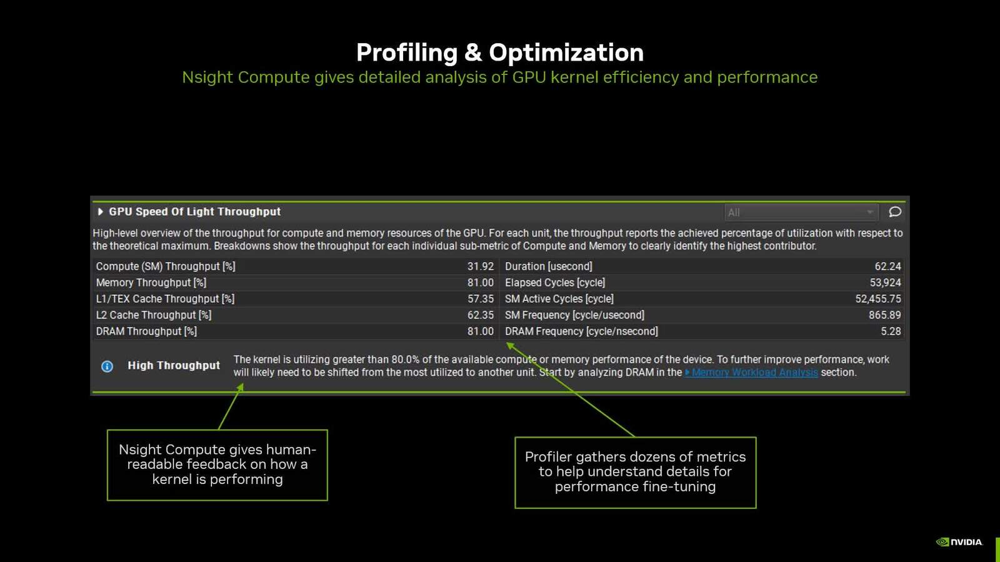
</p>

*Stephen Jones, [How to Write a CUDA Program](https://www.nvidia.com/en-us/on-demand/session/gtcspring23-S51210/), profiling section.*

## 2. Get the Tools Ready

We'll collect the data on the GPU server and read the reports on our own computer. 
So, Your own laptop doesn't need an NVIDIA GPU to open a report.

Both tools have desktop apps for Windows, macOS, and Linux. Copy the report over and open it in the matching app.

<details>
<summary>Install the tools</summary>

You can skip this bit if compatible versions of `nsys` and `ncu` are already installed.

Grab the Linux installers for [Nsight Systems](https://developer.nvidia.com/nsight-systems/get-started) and [Nsight Compute](https://developer.nvidia.com/tools-overview/nsight-compute/get-started). Pick versions that support your GPU and driver. On Ubuntu, run these commands from the download folder:

```bash
sudo apt install ./nsight-systems-*.deb
sudo bash ./nsight_compute-linux-*.run
```

Installing the tools requires sudo. For your own computer, get the desktop apps for your OS from the same pages. The `nsys` viewer should be the [same version or newer](https://docs.nvidia.com/nsight-systems/UserGuide/index.html#sharing-a-report-file) than the server's collector.

</details>

## 3. Start with nsys

Let's run our GEMM through `nsys`. We put the profiler in front of the Python command and tell it what to record. Run this from the project root on the GPU server:

```bash
# Make room for the report and nsys's temporary files.
mkdir -p profiles /tmp/nsys-"$USER"

TMPDIR=/tmp/nsys-"$USER" NSYS_TMPDIR=/tmp/nsys-"$USER" \
nsys profile \
  --trace=cuda,nvtx --sample=none --cpuctxsw=none \
  --capture-range=cudaProfilerApi --capture-range-end=stop \
  -o profiles/gemm_1024 \
  .venv/bin/python 01-GEMM/01-profiling/profile_gemm.py --shape 1024 1024 1024
```

<p align="center">
  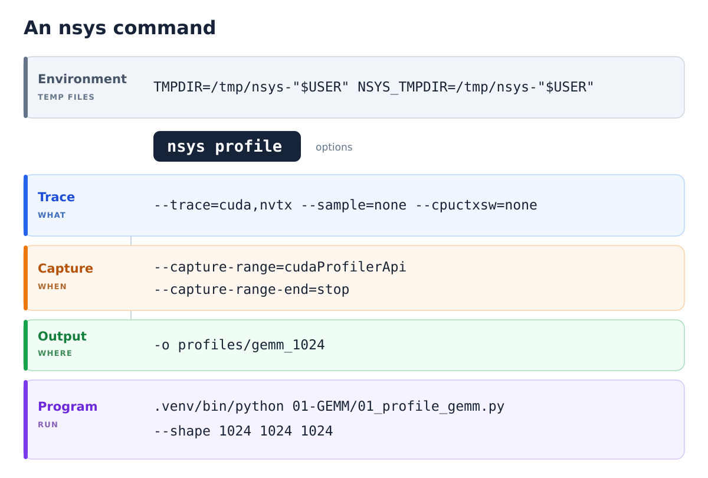
</p>

For now, let's focus on **Trace** and **Capture**.

**Trace chooses what we record.** `cuda` records CUDA calls and GPU work; `nvtx` adds our `TileLang` and `PyTorch` labels. Those are the names to look for on the timeline.

> To see where CPU time goes, `--sample` periodically checks which code is running. To see when threads get CPU time, `--cpuctxsw` records when they are scheduled in or switched out.
>
> For our GEMM comparison, let's keep both at `none`. CUDA events and NVTX labels are still recorded.

**Capture chooses when we record.** Our [script](profile_gemm.py) uses the same GEMM as last time. It checks the result against PyTorch and warms up both versions first. The `cudaProfilerApi` option lets it start recording after that setup: **20 calls to each implementation**, and then stop.

You'll find the report at `profiles/gemm_1024.nsys-rep`. Download the report, then double-click it.


## 4. Find Our GEMM

When you open the report, you'll see a timeline full of colored bars. Let's zoom in on one GEMM call.

Look for a `TileLang` or `PyTorch` label. Under **CUDA HW**, click the GPU kernel for that call to see its details.

The screenshots below show one call from each. Red **1** marks the kernel, orange **2** its duration, and green **3** its launch details.

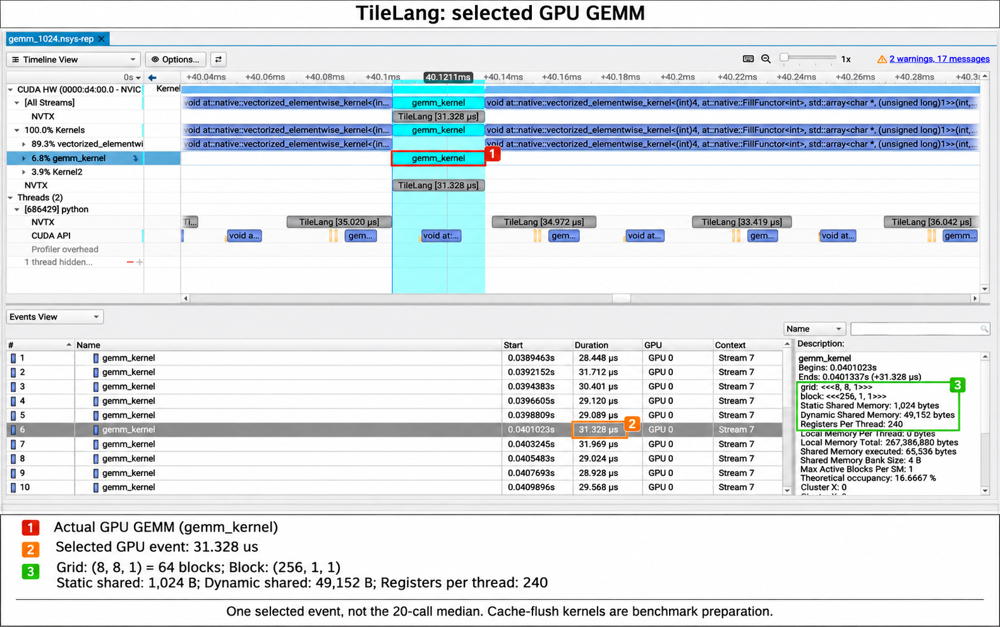


Keep an eye on the GPU event's **Duration**.    
If Description says **Kernel launcher**, you've clicked a CPU launch call. Move to the GPU event to read the execution time. The gray CPU/NVTX ranges mark our Python calls; the GPU row shows the work they launch.

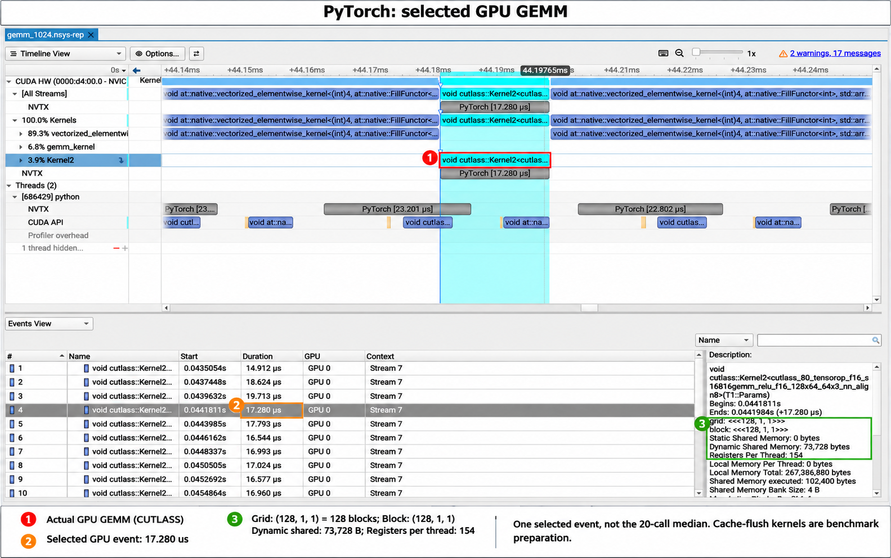


The TileLang kernel takes **31.328 µs** in the first screenshot, while PyTorch takes **17.280 µs** in the second.

Don't forget, compare the **Duration** numbers, not the widths of the bars!

That's just one call from each. Let's check **all 20 calls from each version**:

```bash
nsys stats --report nvtx_kern_sum profiles/gemm_1024.nsys-rep
```

Here's what we get:

| | TileLang | PyTorch |
| --- | ---: | ---: |
| GEMM kernels per call | 1 | 1 |
| Median GPU duration | 29.26 µs | 16.98 µs |

> The `FillFunctor<int>` events clear the cache before each GEMM. Leave them out when comparing the GEMM timings.

This run uses an **RTX 5090 D v2** with `M=N=K=1024`.    
And, the first lesson's screenshot came from a **4070 SUPER**. 

We've found a useful clue.
> TileLang's kernel takes about 72% longer here. 


## 5. A Clue in the Grid

Look at **Grid** in the two nsys screenshots. Here's that part of each:

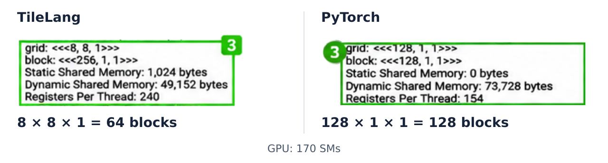

TileLang launches `8×8×1 = 64 blocks`;\
PyTorch launches `128×1×1 = 128 blocks`.\
And, our GPU has **170 SMs**.\
Generally speaking, each block runs on one SM.
So, our 64 blocks can use at most 64 SMs at once.

That gives us something to try:

```text
128×128 tiles → 8×8  =  64 blocks
128×64  tiles → 8×16 = 128 blocks
```
> **Make a guess: would shrinking the tile again to `128×32` make it faster still?**

I went ahead and tested nine tile shapes. Let's see how your guess holds up.

On the left, we keep `BM=128` and change `BN`. The right shows all nine combinations.

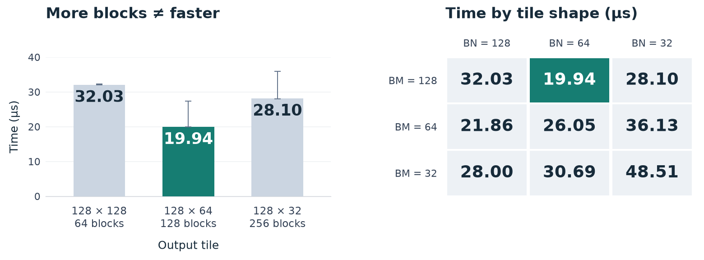


**The `128×64` tile is definitely the fastest in this test.** Going from 64 to 128 blocks helps, but going to 256 makes it slower again. Block count isn't the whole story: smaller tiles also change [how much input a block can reuse](https://docs.nvidia.com/deeplearning/performance/dl-performance-matrix-multiplication/index.html#typical-tile-dimensions-in-cublas-and-performance).

We have a tile to try. Next, let's use `ncu` to look inside the kernel.


## 6. Follow the Clues with ncu

We'll use [NVIDIA's Compute Triage Guide](https://docs.nvidia.com/nsight-compute/ComputeTriage/index.html) to interpret the ncu preport and decide what to optimize first.


### 1. Are the collected metrics trustworthy?

> ***If the information collected is incorrect, any conclusions are meaningless.***

<p align="center">
  
</p>

My dear friend, please don't rush to modify the code yet. **First**, Let's check if we can compare the results fairly. 
Actually, I ran several tests, and the kernel took less time with each run. **Wow**, what a tremendous speedup!   
But, was that really because of our code changes?

In fact, the GPU clock speeds during those runs were 2.55, 2.61, 2.90 GHz. 
At higher clock speeds, the same computation can definity take less time.
So, frustratingly, the **Duration** values alone don't tell us how much of the speedup came from our code changes.

From now on, we'll use the base clock speed and compare all configurations under the same profiling conditions. 
These settings can affect the timings reported by ncu and nsys. 
See the [Profiling Guide](https://docs.nvidia.com/nsight-compute/ProfilingGuide/index.html#clock-control) for details.


Let's collect a report. Run the commands below from the **project root**.

Start with our original `128×128×32` configuration. Near the top of [profile_gemm.py](profile_gemm.py), set the `gemm.compile` parameters to:

```python
kernel = gemm.compile(
    M=M, N=N, K=K, BM=128, BN=128, BK=32,
    THREADS=128, STAGES=3,
)
```

Then run `ncu`:

```bash
ncu --set full --clock-control base \
  --nvtx --nvtx-include TileLang/ -c 5 \
  -f -o profiles/tilelang_128x128x32 \
  .venv/bin/python 01-GEMM/01-profiling/profile_gemm.py
```

Here's what the main options do:

- `--set full` collects detailed metrics.
- `--clock-control base` uses the GPU's base clock speed.
- `--nvtx --nvtx-include TileLang/` profiles only kernels in the `TileLang` NVTX range.
- `-c 5` profiles five kernel launches.


### 2. Is the workload too small to saturate the GPU?

Let's go back to our original configuration. Open `tilelang_128x128x32.ncu-repz`.

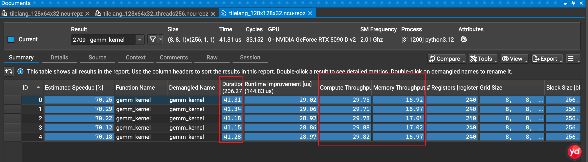

The five rows are our **five kernel calls**. Focus on the columns marked in red:

- **Duration** is the kernel's execution time: about **41 µs** per call.
- **Compute Throughput** is about **30%** of peak.
- **Memory Throughput** is about **17%** of peak.

Both throughput values are below 30%. Does the kernel have enough work to use the whole GPU? Let's check the grid.

Click **Details** next to **Summary**, then scroll down to **Launch Statistics**:

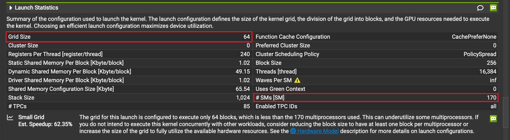

The **Grid Size** is **64 blocks**, while our GPU has **170 SMs**.

In our GEMM, `BM` and `BN` set the output tile size for each block. Here's how they determine the grid size:

```text
M = N = K = 1024
BM = BN = 128

grid size = ceil(M / BM) * ceil(N / BN) = 8 * 8 = 64
```

Each block runs on one SM, so these 64 blocks can use at most **64 of the 170 SMs** at once. That leaves at least **106 SMs** with no work from this kernel at any given time.

Further down in **Details**, expand **GPU and Memory Distribution** and look at **Workload Distribution**:

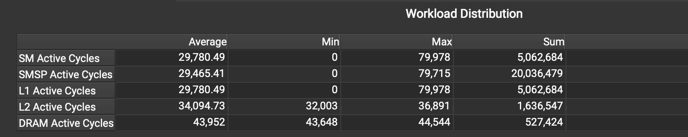

The **SM Active Cycles** row shows a minimum of **0** and a maximum of about **80,000 cycles**. The average across all 170 SMs is only about **29,800 cycles**, because it includes SMs with no work from this kernel.

Now change only `BN` from `128` to `64`, keeping the other parameters the same. With `BM=128, BN=64, BK=32`, the grid grows to `8×16 = 128 blocks`.

Run `ncu` again with the same options. Use `-o profiles/tilelang_128x64x32` for the new report.

**Wow**, the kernel now takes about **24 µs**!

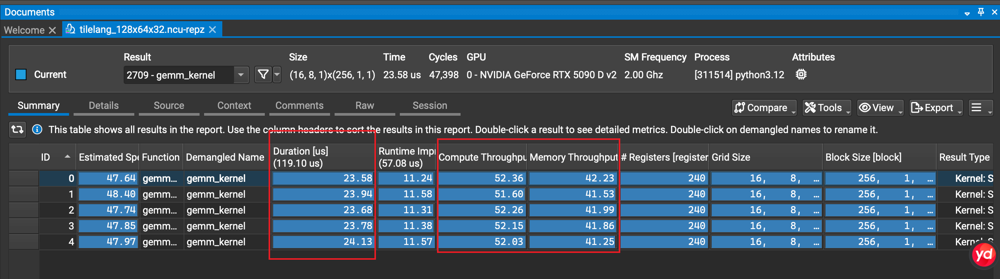

Compute throughput is now about **52%**, and memory throughput is about **42%**. Here's how the two configurations compare:

| Metric | 128×128×32 | 128×64×32 |
| --- | ---: | ---: |
| Grid Size | 64 | 128 |
| Actual Block Size (threads) | 256 | 256 |
| Compute Throughput | 29.78% | 52.15% |
| Memory Throughput | 16.97% | 41.86% |

The larger grid lets more SMs work on the kernel at once. In the final comparison below, this change reduces **Duration** from **41.216 µs** to **23.968 µs**, about **42% less time**.

Try a few more values for `BM` and `BN`. Watch how **Grid Size**, throughput, and **Duration** change. Use **Duration** to judge which configuration is faster.

> Want to test these configurations automatically? Take a look at [TileLang's autotuner](https://tilelang.com/programming_guides/autotuning.html).


### 3. Will more threads help?

For our `128×64×32` configuration, compute and memory throughput are still below 60% of peak. Let's check whether the schedulers have enough warps ready to issue instructions. As we go, keep one question in mind: **does a higher percentage always mean a faster kernel?**

Open **Occupancy** and **Scheduler Statistics** under **Details**.

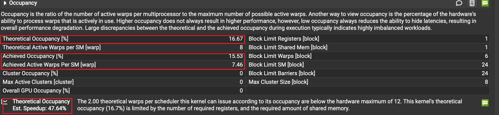

The screenshot shows **16.67% theoretical occupancy** and **15.53% achieved occupancy**. These values are close, so the kernel is already near the occupancy limit for this launch configuration.

Low occupancy gives the schedulers fewer active warps to choose from, and an active warp may still be waiting for data or a dependency. An **eligible warp** is ready to issue its next instruction. Check **Eligible Warps/Scheduler** and **Issue Active** to see how many warps are ready and how often instructions are issued. [NVIDIA's metric descriptions](https://docs.nvidia.com/nsight-compute/ProfilingGuide/index.html#sections-and-rules) explain these distinctions.

Let's try more threads while keeping `BM=128, BN=64, BK=32, STAGES=3` fixed. The table includes the actual block size reported by ncu, which differs from the `THREADS` setting in this kernel.

| Metric | THREADS=64 | THREADS=128 | THREADS=256 | THREADS=512 |
| --- | ---: | ---: | ---: | ---: |
| Actual Block Size (threads) | 192 | 256 | 384 | 640 |
| Registers/thread | 240 | 240 | 168 | 56 |
| Achieved Occupancy | 11.49% | 15.50% | 23.72% | 39.95% |
| Eligible Warps/Scheduler | 0.053 | 0.102 | 0.178 | 0.312 |
| Issue Active | 5.18% | 10.02% | 14.95% | 21.43% |
| Compute Throughput | 30.39% | 52.12% | 58.39% | 59.54% |
| Elapsed Cycles | 81,684 | 47,876 | 43,198 | 43,226 |

Going from `THREADS=64` to `256` increases occupancy and the number of eligible warps. The schedulers issue instructions more often, and **Elapsed Cycles** falls from **81,684** to **43,198**.

What happens at `THREADS=512`? Occupancy rises to **39.95%** and **Issue Active** reaches **21.43%**, but the kernel still takes about **43,200 cycles**. The cycle count is almost unchanged.

For more detail, open **Compute Workload Analysis** and select **Pipe Utilization (Active Cycles)**:

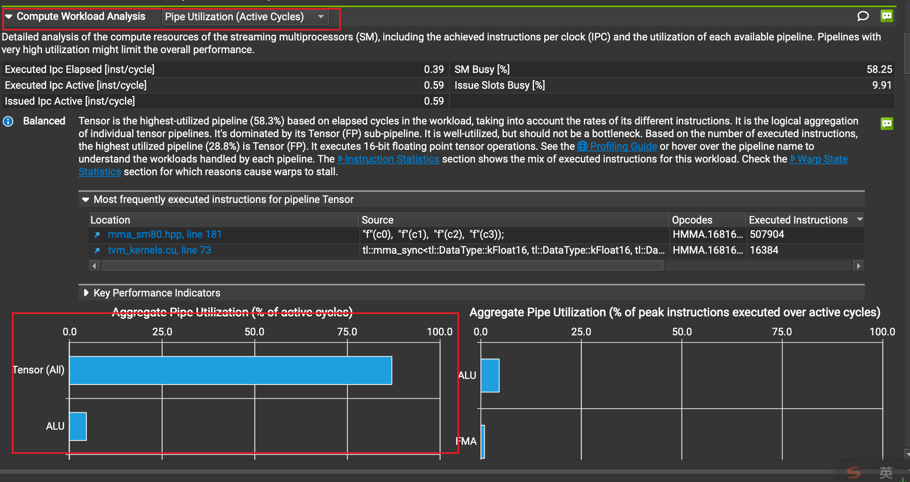

The **Tensor (All)** bar is around **87% of SM active cycles**. Since `THREADS=256` and `512` take almost the same number of cycles, we'll keep **`THREADS=256`**.


### 4. Tune the pipeline with STAGES

With the tile size and thread count chosen, let's look at how a block loads data and performs its computation.

We keep `BM=128, BN=64, BK=32, THREADS=256`. Each block computes a `128×64` output tile, accumulating results over `1024 / 32 = 32` steps along K. Each step needs a tile of A and a tile of B in shared memory before the compute threads can use them.

With only one set of input buffers, the loading threads must wait until the compute threads finish reading the current data before reusing that memory. A simple schedule looks like this:

```text
Load inputs 0 → Compute step 0 → Load inputs 1 → Compute step 1 → …
```

During each load, the compute threads wait for data. We'd like to prepare the next inputs while computing the current step.

**`STAGES` controls how many input buffer sets this kernel uses.** Each set holds one A tile and one B tile. With `STAGES=2`, the work can overlap like this:

| Computation | Data loading at the same time |
| --- | --- |
| Compute step 0 using buffer set 0 | Load inputs 1 into buffer set 1 |
| Compute step 1 using buffer set 1 | Reuse buffer set 0 to load inputs 2 |
| Compute step 2 using buffer set 0 | Reuse buffer set 1 to load inputs 3 |

While the compute threads use the current inputs, the loading threads prepare the next ones. If the data arrives in time, computation can continue without waiting for that load. This is the idea behind pipelining. See [NVIDIA's pipelining explanation](https://docs.nvidia.com/cutlass/latest/media/docs/cpp/efficient_gemm.html#pipelining) for more detail.

With 3, 4, or 5 stages, the kernel has 3, 4, or 5 buffer sets. One supplies the current computation, while the others can receive or hold data for later steps. More stages allow loads to start earlier, giving the data more time to arrive while the current computation runs.

These buffers take space. Each additional stage holds another pair of FP16 input tiles: `128×32×2 + 32×64×2 = 12,288 bytes`, or **12 KiB**. A larger shared memory allocation can reduce the number of blocks that fit on an SM at once.

How many stages help this GEMM? Let's keep the other parameters fixed and test `STAGES=1` through `5`.

| Metric | STAGES=1 | STAGES=2 | STAGES=3 | STAGES=4 | STAGES=5 |
| --- | ---: | ---: | ---: | ---: | ---: |
| Duration (µs) | 32.480 | 21.600 | 21.664 | **20.896** | 21.440 |
| Elapsed Cycles | 64,946 | 42,852 | 42,993 | **41,872** | 42,782 |
| Compute Throughput | 38.31% | 58.13% | 58.75% | **59.46%** | 58.70% |
| Memory Throughput | 30.90% | 46.29% | 45.90% | 46.94% | 46.27% |
| Dynamic Shared Memory/block | 12 KiB | 24 KiB | 36 KiB | 48 KiB | 60 KiB |
| Achieved Occupancy | 24.25% | 23.86% | 23.72% | 23.62% | 23.26% |

Start with **1→2 stages**. **Wow**, **Duration** falls from **32.480 µs** to **21.600 µs**, a **33.50% reduction**! Compute throughput rises from 38.31% to 58.13%, while occupancy stays around 24%. The timing improvement is consistent with better overlap between data loads and computation.

For **2→3 stages**, Duration stays near **21.6 µs**. The extra buffer set adds 12 KiB of shared memory per block, with little change in timing. Two stages already provide most of the benefit in this test.

Moving from **3→4 stages** brings Duration down to **20.896 µs** and Elapsed Cycles from **42,993** to **41,872**, making four stages the fastest in this sweep. The stage count can also change the synchronization and loop management code generated by the compiler. 

Finally, **4→5 stages** increases shared memory from **48 KiB** to **60 KiB**. Compute throughput falls slightly, and Duration rises to **21.440 µs**. We'll keep **`STAGES=4`**. 


### 5. How much faster is our kernel?

Our final configuration is `128×64×32 / THREADS=256 / STAGES=4`, with register allocation handled by TileLang and the compiler. Manually setting a register budget did not improve performance in our tests.

In this run, the configurations were tested in turn within the same process, with **five calls per configuration**. Here's how each optimization step compares with the starting point and PyTorch:

| Implementation / configuration | Median Duration (5 calls) | Min–max | Median SM Clock |
| --- | ---: | ---: | ---: |
| Original `128×128×32` | 41.216 µs | 41.056–41.440 µs | 2.009 GHz |
| Set `BN=64` | 23.968 µs | 23.776–24.064 µs | 1.982 GHz |
| Then set `THREADS=256` | 21.696 µs | 21.344–21.728 µs | 1.971 GHz |
| Then set `STAGES=4` | **21.056 µs** | 20.768–21.344 µs | 1.974 GHz |
| PyTorch / cuBLAS | 21.696 µs | 21.504–21.824 µs | 1.973 GHz |

Under the same profiling conditions, the final configuration reduces latency by **2.95%** compared with PyTorch. The grid size, scheduler activity, and pipeline tests help explain each change.

> ***I hope this tutorial can help you get off to a good start with profiling.***


